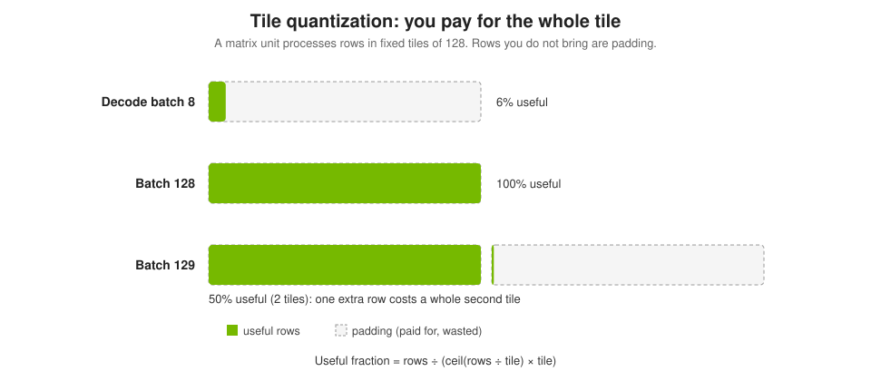
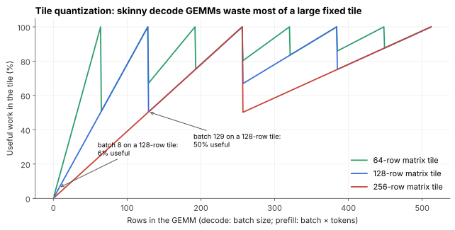
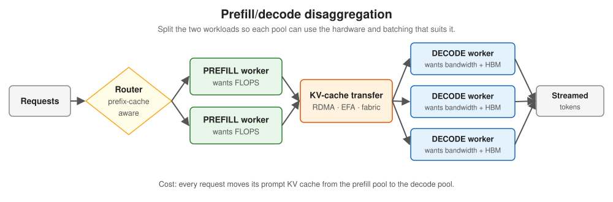

<nav class="toc" markdown="1">
**Contents**

* TOC
{:toc}
</nav>

---

## 0. The puzzle spec sheets cannot answer

An AMD MI355X and an NVIDIA B300 have nearly identical spec sheets: about 5 PF of dense FP8, 288 GB of HBM, 8 TB/s of bandwidth. Serving DeepSeek R1, the measured cost per token differs by about <b>3x</b>.

Now flip it. AWS Trainium3 has half the memory of either GPU, and a 144-chip Trn3 UltraServer still matches a 72-GPU GB300 rack on FP8 compute, memory capacity, and bandwidth. OpenAI Jalapeño has less HBM than a B300 and reports up to 1.9x more throughput per watt.

Same specs, different cost. Less memory, same performance. <b>None of the headline numbers explain any of this.</b> Performance comes out of a chain:

```txt
Model shape → workload shape → arithmetic intensity → bytes moved → energy per byte
→ compute → communication → scheduling → latency / throughput / cost per token
```

This post walks that chain once, and at every link asks the same question of the same chips. By the end you will be able to explain all three results from first principles before looking at a benchmark.

<div class="pullquote" markdown="1">
<b>The recurring theme:</b> do not optimize for the chip. Identify what prevents the chip from doing useful work, and remove that.
</div>

---

## 1. The contenders, and the ten rules

### The contenders

| Chip | Type | Status (November 2026) | What it teaches |
| --- | --- | --- | --- |
| <b>NVIDIA</b> B300 (Blackwell Ultra), Rubin | General-purpose GPU | B300 shipping; Rubin ramping | The default: maximum flexibility, the most mature software, NVLink rack-scale domains |
| <b>AMD</b> Instinct MI355X, MI455X (Helios rack) | General-purpose GPU | MI355X shipping; MI455X sampling | Matching a B300 on paper does not mean matching it on cost per token: scale-up domain size and software maturity decide. Also the open path: ROCm, UALink, and the Helios rack |
| <b>AWS Trainium3</b> (Trn3 UltraServer) | Hyperscaler ASIC for training and inference | Shipping on EC2 | What changes when software, not hardware, schedules the chip: compiler-managed SRAM, 16 dedicated collective cores, and a 144-chip scale-up domain, traded for no FP4 speedup and a smaller kernel community |
| <b>OpenAI Jalapeño</b> | Inference-only ASIC | Internal deployment | What a model company builds when it designs silicon around its own serving patterns |

### The ten rules that explain everything below

| Rule | Statement | Section |
| --- | --- | --- |
| Roofline | Attainable speed = min(peak compute, arithmetic intensity × memory bandwidth) | 3 |
| Memory-bandwidth lower bound | Each decode step reads every weight once, so step time ≥ weight bytes ÷ bandwidth | 3 |
| Weight reuse vs KV reuse | Batching shares weight reads; KV cache reads are per sequence and never shared | 3, 4 |
| KV size | Bytes per token = 2 × layers × KV heads × head dim × bytes per element | 4 |
| Data-movement energy | Reading a byte from DRAM costs far more energy than computing on it | 5 |
| Tile quantization | Fixed-size matrix tiles are paid for in full even when mostly empty | 6 |
| α–β model | Message time = α (startup latency) + size ÷ β (bandwidth) | 7 |
| Little's law | Requests in flight = arrival rate × time in system | 12 |
| Pipeline bottleneck | A pipeline runs at the speed of its slowest stage | 11, 12 |
| Queueing | Waiting time explodes as utilization approaches 100% | 12 |

---

## 2. What is physically different inside the chips

<b>Intuition.</b> A GPU is thousands of programmable workers sharing caches the hardware manages. An ASIC is a few very large math engines fed by a scratchpad that software, the compiler or a custom kernel, fills ahead of time. Both are programmable. They differ in where the flexibility lives and who does the optimization work.

<figure><figcaption>Both designs exist to keep data on chip. The GPU uses many small SRAMs and hardware schedulers; Trainium3 uses eight cores with 32 MiB of software-managed SBUF each, fed by explicit DMA that the compiler or an NKI kernel schedules.</figcaption></figure>

<b>Systems view.</b> Both designs have software-managed SRAM: shared memory on a GPU, SBUF on Trainium3. The difference is what sits behind it. A GPU also has a hardware-managed L2 cache and hardware warp schedulers, so irregular access patterns and changing shapes are absorbed by cache hits and by switching to another warp. Trainium3 has no hardware cache: every byte moves by an explicit DMA transfer, scheduled ahead of time by the Neuron compiler or by an NKI kernel. When the work is predictable, that schedule wastes nothing; when shapes change, the schedule has to be rebuilt, which is why Trainium serving stacks compile per shape bucket. Trainium3 adds ISA support for dynamic shapes, which narrows that gap without removing it. This trade-off, explicit and efficient versus forgiving and flexible, is the core difference between a GPU and an AI ASIC.

### Across the chips: anatomy

|  | NVIDIA B300 | AMD MI355X | AWS Trainium3 | OpenAI Jalapeño |
| --- | --- | --- | --- | --- |
| Compute units | Over 100 SMs, each with Tensor Cores and SIMD lanes | 256 CUs with Matrix Cores | 8 NeuronCore-v4, each a 128×128 systolic array plus vector, scalar, and GpSimd engines | Not disclosed |
| On-chip memory | Small shared memory per SM + hardware-managed L2 | LDS per CU + 256 MB Infinity Cache | 256 MiB software-managed SBUF (32 MiB per core) | Not disclosed |
| Control | Hardware warp schedulers | Hardware wavefront schedulers | Static schedule built in software (compiler or NKI); ISA extensions for dynamic shapes | Not disclosed |
| Collectives | NCCL on the SMs | RCCL on the CUs | Neuron collectives (aws-neuronx-collectives) on 16 dedicated CC-Cores, SBUF to SBUF | Not disclosed |
| Low-precision formats (all also run BF16 and FP16) | FP8, MXFP8, MXFP6, MXFP4, NVFP4; FP4 at 3x the FP8 rate | FP8, MXFP8, MXFP6, MXFP4; FP4 at 2x the FP8 rate | MXFP8, MXFP4; MXFP4 at the MXFP8 rate | MXFP4 (only format disclosed) |
| Process | TSMC 4NP | TSMC 3 nm compute dies, 6 nm base dies | TSMC N3P | TSMC (reported) |

### Why build an ASIC at all

Every accelerator has the same three fixed budgets: <b>die area, power, and the HBM interface</b>. A GPU spends its budget on generality: thousands of thread contexts, register files, hardware schedulers, caches, and number formats some customer somewhere needs. That is insurance against unknown workloads. An ASIC asks what LLM inference actually binds on (bytes moved, on-chip reuse, chip-to-chip traffic), drops the insurance, and spends the budget there.

Think of a kitchen equipped for any cuisine against one built only for ramen. The ramen kitchen does not have a better chef. It has no idle equipment, and every square metre goes to the steps that slow ramen down.

GPUs are moving the same way. Blackwell Ultra cut FP64 from about 40 TF on B200 to about 1.4 TF and spent the area on FP4. MI355X still carries 78.6 TF of FP64 for HPC customers.

What the reallocation buys, beyond cost:

- <b>Communication that does not steal compute.</b> On GPUs, collectives run on the same SMs as the math. DeepSeek-V3 gave 20 of 132 H800 SMs (about 15%) to all-to-all, and asked hardware vendors to offload communication from the SMs. Trainium3 ships 16 dedicated collective cores per chip.
- <b>More on-chip memory for reuse.</b> Trainium3 has 8 × 32 MiB = 256 MiB of SBUF per chip. For scale, an H100 has 228 KB of shared memory per SM × 132 SMs ≈ 30 MB.
- <b>Larger scale-up domains</b> (chips joined by the scale-up interconnect, before traffic leaves for the scale-out network). <b>Trn3 UltraServer:</b> 144 Trainium3 chips over NeuronLink-v4 through NeuronSwitch-v1. <b>Jalapeño</b>: 128 chips per rack over Ethernet. GB300 NVL72: 72 GPUs over NVLink.
- <b>More tokens per watt.</b> Jalapeño moves 15.4 TB/s of HBM traffic on a 700 W budget, about 22 GB/s per watt. A B300 or an MI355X moves 8 TB/s on 1,400 W, about 5.7 GB/s per watt, roughly a quarter as much.

The DeepSeek-V3 example shows the trade-off concretely: in the DeepSeek-V3 technical report, DeepSeek, training on NVIDIA H800 GPUs, asked hardware vendors to move communication off the SMs, which is what dedicated collective cores do.

### Less memory per chip, same performance

The first objection to Trainium3 is the spec sheet: 144 GB at 4.9 TB/s, against 288 GB at 8 TB/s on a B300. Half the memory. How can it keep up?

Compare the unit you actually buy. Nobody serves a frontier model on one chip. You buy a fleet, and an ASIC chip is simply a smaller building block.

| Per unit | 1 × NVIDIA B300 | 2 × AWS Trainium3 |
| --- | --- | --- |
| FP8 dense | 5.0 PF | 5.03 PF |
| FP4 dense | 15 PF | 5.03 PF (MXFP4 runs at the MXFP8 rate) |
| HBM capacity | 288 GB | 288 GB |
| HBM bandwidth | 8 TB/s | 9.8 TB/s |

At rack scale: 144 Trainium3 chips give 362 PF FP8, 20.7 TB of HBM and 706 TB/s, against 360 PF, 20.7 TB and 576 TB/s for 72 B300s. The capacity worry is a per-chip artifact. The real gap is FP4: 72 B300s deliver about 3x the FP4 throughput, which matters for FP4 prefill.

Jalapeño makes the same argument from the other direction: less HBM than a B300 (216 GiB vs 288 GB) but nearly twice the bandwidth at half the power. Section 3 shows why capacity was never the scarce resource for decode; bytes per second were.

<b>What the reallocation costs.</b> Flexibility. A new operator lands on GPUs first, usually as a community Triton or CUDA kernel; on Trainium it needs an NKI kernel. FP4 runs no faster than FP8 on Trainium3. And Trainium is rented only through AWS, while Jalapeño is for OpenAI's internal usage so far. These costs weigh most on models that change often; at large, steady scale they are paid once.

<div class="callout callout-gray" markdown="1">
<span class="callout-icon">🎯</span>

<b>Interview Lens:</b> <i>Trainium3 has half the HBM of a B300. Why is that not a problem?</i> The comparison unit is wrong. Two Trainium3 chips match one B300 on FP8 and HBM capacity and exceed it on bandwidth. <i>Follow-up: where does the comparison break?</i> FP4. Trainium3 gets no FP4 speedup, so FP4 prefill favors the GPU by about 3x.

</div>

---

## 3. Prefill vs decode: why one request stresses hardware two ways

<b>Intuition.</b> <b>Prefill</b> reads the whole prompt at once: lots of math, very parallel. <b>Decode</b> writes one token at a time: very little math per step, but every step re-reads all the weights and the whole KV cache.

<figure></figure>

<b>Deep dive: tensor shapes.</b>

```txt
PREFILL (S prompt tokens)                 DECODE (1 new token per step)
Q:     [B, H,    S, D]                     Q:        [B, H,    1, D]
K, V:  [B, H_kv, S, D]                     K cache:  [B, H_kv, S, D]   read every step
MLP:   [B*S, d_model] x [d_model, d_ff]    V cache:  [B, H_kv, S, D]   read every step
       → fat matrix multiplies             MLP:      [B, d_model] x [d_model, d_ff]
                                                     → skinny, nearly matrix-vector
```

Changing <b>S to 1</b> is the whole story: the same weight matrix, multiplied by B rows instead of B × S rows.

<b>The roofline.</b> Arithmetic intensity is FLOPs per byte moved from memory. Every chip has a <b>ridge point</b>, peak FLOPs divided by peak bandwidth. Below the ridge the kernel is <b>memory-bound</b>: the math units wait for bytes and extra FLOPs do nothing. Above it, the kernel is <b>compute-bound</b>.

For FP8 decode, arithmetic intensity is roughly <b>2 × batch</b> FLOPs per byte (each weight byte does one multiply-add per sequence in the batch). Prefill arithmetic intensity is roughly 2 × batch × prompt length, far above any ridge.

<figure><figcaption>Roofline for every accelerator in this post, with Llama 3.3 70B decode at batch 1, 64, and 256 (weights only), the maximum arithmetic intensity at 32K context for any batch, and an 8K-token prefill. Everything in the shaded band is memory-bound on every chip.</figcaption></figure>

<b>Latency is two numbers, throughput a third.</b> <b>TTFT</b> (time to first token) is driven by prefill plus queueing. <b>TPOT</b> (time per output token) is driven by decode. <b>Throughput</b>, in output tokens or requests completed per second, is measured at a given concurrency: more concurrent requests raise throughput until TTFT or TPOT misses its target. A chip can be great at one and mediocre at another, which is the root reason for prefill/decode disaggregation (Section 11).

### Across the chips: the running example at batch 1

<b>The running example.</b> Every number from here on uses Meta Llama 3.3 70B (80 layers, 8 KV heads, head dim 128, about 70.6B parameters), so about 70 GB of FP8 weights and 160 KiB of FP8 KV cache per token, at the 8K-in / 1K-out shape SemiAnalysis InferenceX benchmarks. AWS Trainium figures are for Trainium3 and the Trn3 UltraServer.

Minimum time per token = 70 GB of weights ÷ HBM bandwidth. No kernel can beat it.

|  | NVIDIA B300 | AMD MI355X | NVIDIA Rubin | AMD MI455X | AWS Trainium3 | OpenAI Jalapeño |
| --- | --- | --- | --- | --- | --- | --- |
| HBM bandwidth | 8 TB/s | 8 TB/s | 19.2 TB/s | 23.3 TB/s | 4.9 TB/s | 15.4 TB/s |
| Minimum time per token, one chip | 8.75 ms | 8.75 ms | 3.6 ms | 3.0 ms | 14.3 ms | 4.5 ms |
| Max tokens/s for one user | 114 | 114 | 274 | 333 | 70 | 220 |
| Ridge point | ≈ 625 FLOP/B | ≈ 625 FLOP/B | ≈ 910 FLOP/B | ≈ 860 FLOP/B | ≈ 515 FLOP/B | ≈ 870 FLOP/B (MXFP4) |
| Batch at which decode becomes compute-bound | ≈ 312 | ≈ 312 | ≈ 455 | ≈ 430 | ≈ 257 | ≈ 218 (FP4 weights) |

In principle, a large enough batch lifts decode past the ridge. In practice, the KV cache stops every chip short of it, as the next section shows.

<b>Reading the table.</b> Every one of these chips ships inside a larger system, so the table compares building blocks, not products. Trainium3 is the smallest block: two of them exceed one B300 on bandwidth. Across generations, <b>compute grows faster than memory bandwidth</b>, so each new chip has a higher ridge point and leaves decode further below it.

<div class="callout callout-gray" markdown="1">
<span class="callout-icon">🎯</span>

<b>Interview Lens:</b> <i>Why does doubling FLOPS not double tokens per second?</i> Decode sits on the sloped part of the roofline. Doubling FLOPS raises a ceiling decode never reaches. Doubling bandwidth moves the slope decode is actually on.

</div>

---

## 4. The KV cache: the capacity wall

<b>Intuition.</b> Every token a user has sent or received leaves a record in memory, the KV cache. Batching is a carpool: one read of the weights serves every passenger. But every passenger brings luggage, its own KV cache, and the luggage does not shrink when you add riders. Add enough riders and you are mostly moving luggage.

```txt
KV bytes per token = 2 (K and V) × 80 layers × 8 KV heads × 128 head dim × 1 byte (FP8)
                   = 163,840 bytes = 160 KiB per token
4K-token sequence   → ≈ 0.67 GB
32K-token sequence  → ≈ 5.4 GB
128K-token sequence → ≈ 21.5 GB
```

With batch B, weight bytes are shared but KV bytes grow with B, so arithmetic intensity stops rising and converges to a per-sequence limit:

```txt
arithmetic intensity(B)  ≈  (2P + attention FLOPs) × B  /  (P × bytes_per_param  +  B × KV_bytes_per_seq)
B → ∞:        ≈  (2P + attention FLOPs)  /  KV_bytes_per_seq
```

| Context | KV per sequence | Max decode arithmetic intensity at any batch |
| --- | --- | --- |
| 8K | 1.34 GB | ≈ 120 FLOP/B |
| 32K | 5.4 GB | ≈ 42 FLOP/B |
| 128K | 21.5 GB | ≈ 22 FLOP/B |
| Limit (attention only, GQA-8, FP8 KV) |  | 16 FLOP/B |

Every value sits below every ridge point in Section 3 (515 to 910 FLOP/B). <b>At 8K context and beyond, this model's decode is memory-bound on every chip in this post, at any batch size.</b>

### Across the chips: how many conversations fit

FP8 stores each of Llama 3.3 70B's 70.6 billion parameters in 8 bits, one byte, so the weights take about 70 GB; whatever HBM is left holds the KV cache.

|  | NVIDIA B300 | AMD MI355X | NVIDIA Rubin | AMD MI455X | AWS Trainium3 | OpenAI Jalapeño |
| --- | --- | --- | --- | --- | --- | --- |
| HBM | 288 GB | 288 GB | 288 GB | 432 GB | 144 GB | 216 GiB (≈ 232 GB) |
| Free for KV | ≈ 218 GB | ≈ 218 GB | ≈ 218 GB | ≈ 362 GB | ≈ 74 GB | ≈ 162 GB |
| 4K-token sequences that fit | ≈ 325 | ≈ 325 | ≈ 325 | ≈ 539 | ≈ 110 | ≈ 241 |
| 32K-token sequences that fit | ≈ 40 | ≈ 40 | ≈ 40 | ≈ 67 | ≈ 13 | ≈ 30 |
| Arithmetic intensity at the 4K max batch | ≈ 170 FLOP/B | ≈ 170 FLOP/B | ≈ 170 FLOP/B | ≈ 188 FLOP/B | ≈ 115 FLOP/B | ≈ 157 FLOP/B |
| Share of the chip ridge point | 27% | 27% | 19% | 22% | 22% | under 20% |

<b>The key insight.</b> Even with HBM packed full of conversations, every chip runs decode at under 30% of its ridge point. KV traffic grows with every sequence you add. That is why, for this model, memory bandwidth, HBM capacity, and KV cache design set decode speed, while extra peak FLOPS barely move it. Three things help: <b>more bandwidth per dollar or per watt </b>(the approach the Trn3 UltraServer and Jalapeño take),<b> more HBM capacity, and a different attention design such as MLA or KV quantization.</b>

<div class="callout callout-gray" markdown="1">
<span class="callout-icon">🎯</span>

<b>Interview Lens:</b> <i>Why can no chip make long-context GQA decode compute-bound?</i> Every sequence brings its own KV bytes, so arithmetic intensity converges to a per-sequence limit far below any ridge point. Raising that limit takes fewer KV bytes per token, as with MLA or KV quantization, or more queries per KV read, as with speculative decoding.

</div>

---

## 5. Energy: why inference ASICs exist at all

<b>Intuition.</b> Math is cheap; moving data is expensive. In a data center with a fixed power budget, the chip that spends less energy moving bytes serves more tokens.

```txt
Energy per operation (45 nm process):
  32-bit read from off-chip DRAM  ≈ 640 pJ
  32-bit floating-point multiply  ≈ 3.7 pJ      → moving the data costs ≈ 170x the math

Bytes read per decode token (70 GB of FP8 weights):
  batch 1:   70 GB per token, ≈ 2 FLOPs per byte
  batch 64:  70 GB ÷ 64 ≈ 1.1 GB per token
```

At batch 1, decode does about two FLOPs for every byte it pulls from HBM, so almost all of its energy goes to moving weights. Batching divides the weight bytes per token, which makes <b>batching an energy optimization, not only a throughput one</b>.

Three levers cut energy per token: keep more data on chip, move fewer bits per value, and spend silicon and power on data movement rather than on flexibility decode does not use.

### Across the chips: energy strategy

|  | NVIDIA | AMD | AWS Trainium | OpenAI Jalapeño |
| --- | --- | --- | --- | --- |
| Main lever | NVFP4 at 3x the FP8 rate: fewer bytes per weight | Large HBM (MI455X: 432 GB): fewer chips per model, less inter-chip traffic | Explicitly scheduled SRAM reuse (compiler or NKI); collectives that move data SBUF to SBUF | Bandwidth first: 15.4 TB/s at 700 W |
| HBM bandwidth per watt | ≈ 5.7 GB/s per W (B300) | ≈ 5.7 GB/s per W (MI355X) | ≈ 5.8 GB/s per W (Trainium2) | ≈ 22 GB/s per W |
| Efficiency gain | 5x throughput per MW vs Hopper (GB300 NVL72) | 38x perf per watt vs 2020 node (MI355X) | 4x perf per watt vs Trn2 UltraServer | 1.5x to 1.9x throughput per watt vs GB200 and GB300 |

<b>Reading the table.</b> Jalapeño is the energy-first design: about 4x the bandwidth per watt of a B300. AWS publishes Trainium3 efficiency only against its predecessor. "ASIC" alone does not mean "more efficient"; where the design spends its power budget does.

<div class="callout callout-gray" markdown="1">
<span class="callout-icon">🎯</span>

<b>Interview Lens:</b> <i>How can an inference ASIC beat a faster GPU on cost per token?</i> Decode is limited by bytes moved, and moving bytes is where the energy goes. A chip that moves bytes more cheaply serves more tokens per watt, and a power-capped data center converts tokens per watt directly into throughput.

</div>

---

## 6. Tile quantization: the hidden tax on small batches

<b>Intuition.</b> Matrix units work on fixed-size blocks. If the block has room for 128 rows and you bring 8, you pay for 128 and get 8.

<figure></figure>

<figure><figcaption>Tile quantization: decode batch 8 on a 128-row tile does 6% useful work; batch 129 drops back to 50% because one extra row costs a whole tile.</figcaption></figure>

```txt
Useful fraction = rows ÷ (ceil(rows ÷ tile) × tile)
batch 8,   tile 128 → 6%
batch 128, tile 128 → 100%
batch 129, tile 128 → 50%   (one extra row costs a whole tile)
```

Prefill fills tiles easily (batch × prompt rows). Decode at small batch wastes most of each tile, on top of being memory-bound. Utilization counters can look healthy while most of the work is padding. At small batch the bandwidth limit binds first; tile quantization starts to cost real throughput as batch grows toward the ridge.

### Across the chips: matrix unit granularity

|  | NVIDIA | AMD | AWS Trainium | OpenAI Jalapeño |
| --- | --- | --- | --- | --- |
| Matrix unit | Tensor Core MMA with M of 64 or 128 per thread block, 256 per CTA pair (Blackwell) | MFMA on 16- or 32-row blocks per wavefront | 128×128 systolic array per NeuronCore | Not disclosed |
| Small-batch handling | Many small tiles run concurrently across SMs; split-K and stream-K | 16-row MFMA tiles; split-K and stream-K in hipBLASLt | Stationary operand loaded into the array, moving operand streamed; batches padded to compiled shape buckets | Not disclosed |

<div class="callout callout-green" markdown="1">
<span class="callout-icon">🛠️</span>

<b>Takeaway:</b> set batch caps and shape buckets at tile multiples, and use speculative decoding to turn one-row decode into multi-row verification (Section 10).

</div>

---

## 7. Communication and scale-up

<b>Intuition.</b> Large models span many chips, and chips must talk every layer. Every message pays a fixed startup latency before any bytes flow, so small messages are all latency and large messages are all bandwidth.

<figure></figure>

```txt
Message time = α (startup latency) + size ÷ β (bandwidth)

Tensor-parallel decode, running example on 8 chips, 32 sequences, BF16 activations:
  one all-reduce ≈ 32 × 8,192 × 2 bytes ≈ 0.5 MB   → time dominated by α
  ≈ 2 all-reduces per layer × 80 layers = 160 per decode step
  → every generated token pays the fabric's startup latency 160 times
```

More link bandwidth barely helps here; lower latency does. That is why serving stacks ship one-shot all-reduce kernels for small messages, and why vendors push reductions into the fabric.

<b>Systems view.</b> Keep tensor parallelism inside the scale-up domain. Place expert parallelism where its all-to-all fits. Only pipeline and data parallelism should cross to scale-out networking.

### Across the chips: scale-up

| Platform | Fast domain | Link per chip | Who runs collectives | Beyond the domain |
| --- | --- | --- | --- | --- |
| NVIDIA GB300 NVL72 | 72 GPUs, one rack | 1.8 TB/s NVLink 5 | NCCL on the SMs; in-switch reduction | RDMA, 800 Gb/s per GPU |
| NVIDIA Vera Rubin NVL72 | 72 GPUs, one rack | 3 TB/s NVLink 6 | NCCL on the SMs, plus in-network compute | RDMA, 1.6 Tb/s per GPU |
| AMD MI355X | 8 GPUs, one node | ≈ 1.1 TB/s Infinity Fabric | RCCL on the CUs | RDMA over Ethernet |
| AMD Helios (MI455X) | 72 GPUs, one rack | 3.6 TB/s UALink over Ethernet | RCCL on the CUs | Ultra Ethernet |
| AWS Trn3 UltraServer (Gen2) | 144 chips: 36 servers × 4 Trainium3 chips, across racks | NeuronLink-v4 through NeuronSwitch-v1: 2,048 GiB/s per chip, carried over PCIe Gen6 links: 256 GB/s within a server, 320 GB/s across servers in a rack, 128 GB/s across racks | Neuron collectives (aws-neuronx-collectives) on 16 dedicated CC-Cores, SBUF to SBUF | EFA |
| OpenAI Jalapeño | 128 chips per rack; 2,048 per pod at 200 GB/s per chip | 600 GB/s local collective network | Not disclosed | Broadcom Tomahawk 6 Ethernet across racks |

<b>The design bets.</b> <b>NVIDIA</b>: a medium-sized domain of fast NVLink links, with reduction in the switch. <b>AMD</b> MI355X: a small, fast node, so expert-parallel MoE crosses scale-out networking; Helios is AMD's answer. <b>Trn3 UltraServer</b>: a 144-chip domain built from switched PCIe Gen6 links, plus dedicated collective cores so communication does not compete with compute. <b>Jalapeño</b>: a 128-chip local domain inside a 2,048-chip Ethernet pod, consistent with a design that spends its budget on memory bandwidth.

<div class="pullquote" markdown="1">
Interconnect bandwidth can matter more than another few hundred TFLOPS.
</div>

---

## 8. Software: the part that often decides real performance

<b>Intuition.</b> A chip is only as fast as the code that runs on it. An excellent chip with a weak compiler loses to weaker hardware with a mature stack.

<figure></figure>

<b>Systems view: where did my kernel go?</b> On a GPU, the engineer writes and tunes the fused kernel. On Trainium, the Neuron compiler fuses and schedules the graph by default, and performance-critical operators are written as NKI kernels:

```txt
Model graph → compiler IR → fusion → tiling → SRAM placement → engine scheduling → accelerator instructions
```

Between NVIDIA and AMD the names differ but the concepts map closely; porting usually fails on tile shapes and wave-size assumptions, not syntax. The real jump is GPU to ASIC: on Trainium there are no threads and no hardware thread scheduler. Occupancy and coalescing disappear as concepts; you reason about SBUF partition layout, which operand stays stationary in the systolic array, and how DMA transfers overlap engine work.

<b>Custom kernels exist on both sides.</b> On Trainium they are written in NKI (Neuron Kernel Interface), a Python-based kernel language that exposes the Neuron ISA directly through <code>nki.isa</code>. AWS maintains the open-source NKI Library of pre-optimized, production-grade kernels, and NKI kernels run inside the PyTorch workflow, so the serving stacks built on it can use them. The difference from CUDA is what you control: no threads to schedule, but explicit tiles, SRAM placement, and DMA transfers.

### Across the chips: the kernel level

| Concept | NVIDIA | AMD | AWS Trainium | OpenAI Jalapeño |
| --- | --- | --- | --- | --- |
| Write a fused kernel in | CUDA, Triton, CUTLASS/CuTe | HIP, Triton, Composable Kernel | NKI (Python, direct ISA access) or the open-source NKI Library; Neuron compiler for the rest of the graph | Internal only |
| Execution unit | SM, warp of 32 threads | CU, wavefront (CDNA 5 moves to Wave32) | NeuronCore-v4: Tensor, Vector, Scalar, GpSimd engines. No threads | Not disclosed |
| Programmer SRAM | Shared memory | LDS | SBUF: 32 MiB per core, 128 partitions | Not disclosed |
| Accumulators | Registers; Tensor Memory on Blackwell | VGPRs / AGPRs | PSUM: 2 MiB per core | Not disclosed |
| HBM to SRAM movement | TMA, async copies | Global / buffer loads | 128 DMA engines, explicit in NKI, scheduled by the compiler | Not disclosed |
| Latency hiding | Hardware swaps warps | Hardware swaps wavefronts | Static schedule: double-buffered tiles, semaphores between engines | Not disclosed |
| Profile with | Nsight Systems / Compute | rocprof, ROCm Compute Profiler | Neuron Explorer (neuron-profile) | Internal |
| Main risk | Few: most mature ecosystem | Long-tail kernel coverage and tuning | Smaller kernel community; new ops need an NKI kernel | No outside access |

---

## 9. Optimization is bottleneck removal

<b>Intuition.</b> Every optimization removes one specific bottleneck. Diagnose first, then pick.

| Symptom | Bottleneck | First fixes |
| --- | --- | --- |
| HBM bandwidth near peak, matrix units idle | Memory bandwidth (memory-bound) | Weight and KV quantization, fusion, larger batch |
| Matrix units saturated | Compute (compute-bound) | Lower precision, better tile shapes |
| Healthy utilization counters, low useful work | Tile quantization | Shape buckets at tile multiples, speculative decoding |
| Many tiny kernels, gaps on the timeline | Kernel launch overhead | Graph capture or static compilation, fusion |
| Chips waiting on each other | Inter-chip communication overhead | Lower tensor-parallel degree, one-shot all-reduce, overlap |
| Batch cannot grow, preemptions | HBM capacity (KV cache) | Paged KV, KV quantization, offload, more chips |
| Good kernels, bad latency | Queueing delay | Lower utilization target, PD disaggregation |

### Across the chips: same principle, different implementation

| Optimization | NVIDIA | AMD | AWS Trainium | OpenAI Jalapeño |
| --- | --- | --- | --- | --- |
| Continuous batching | vLLM, SGLang, TRT-LLM | vLLM, SGLang | vLLM Neuron; SGLang Trainium plugin upcoming (limited beta); batches land in compiled shape buckets | Internal |
| Kernel fusion | Hand-written Triton/CUDA, torch.compile | Triton, Composable Kernel | Neuron compiler plus NKI kernels | Internal |
| FlashAttention-style tiling | FA3 / FA4-class kernels | Ported Triton and CK kernels | NKI flash attention kernel, SBUF-resident tiles | Internal |
| Quantization | FP8, MXFP8, MXFP6, MXFP4, NVFP4 | FP8, MXFP8, MXFP6, MXFP4 | MXFP8, MXFP4 | MXFP4 |
| Launch overhead fix | CUDA Graphs | HIP Graphs | Whole graph compiled per shape bucket and warmed up before serving | Not disclosed |
| Paged KV | PagedAttention | PagedAttention | Block layout must match DMA and SBUF tiling | Not disclosed |
| Speculative decoding | EAGLE, MTP heads | EAGLE, MTP heads | EAGLE3 in vLLM Neuron; draft length is part of the compiled shapes | Not disclosed |
| PD disaggregation | Dynamo, vLLM, SGLang, llm-d | vLLM, SGLang, llm-d | vLLM Neuron (NIXL over EFA) | Not disclosed |

<div class="callout callout-green" markdown="1">
<span class="callout-icon">🛠️</span>

<b>Takeaway:</b> the <i>principle</i> of an optimization transfers across hardware. The <i>implementation</i> often does not. Port the principle, then re-derive the implementation.

</div>

---

## 10. Five workload scenarios

<b>A. Large-batch prefill.</b> Compute-bound. Achievable dense low-precision FLOPS and long-sequence attention kernels decide. High-ridge chips (MI455X, Rubin) shine.

<b>B. Small-batch, latency-first decode.</b> Memory-bound, with kernel launch overhead on top. HBM bandwidth, quantization, static graphs, and speculative decoding decide. Look at measured TPOT, not specs.

<b>C. Long context.</b> KV capacity and KV bandwidth decide (Section 4).

<b>D. Mixture of Experts.</b> Each layer adds two all-to-alls, and the busiest device sets the pace. An ASIC with excellent matrix compute can still lose if its fabric does not match all-to-all traffic.

<figure></figure>

<figure></figure>

<figure></figure>

<b>E. Speculative decoding.</b> Verifying K draft tokens at once turns 1-row decode into K-row decode: higher arithmetic intensity, fuller tiles. Gains shrink at high batch because batching already used the spare compute.

### Across the chips: who fits which scenario

| Scenario | NVIDIA | AMD | AWS Trainium | OpenAI Jalapeño |
| --- | --- | --- | --- | --- |
| A. Prefill | Strong; B300 NVFP4 at 3x FP8 | MI455X: highest FP8 per chip | Lower per chip, no FP4 speedup; judge per dollar | 13.4 PF MXFP4 |
| B. Low-latency decode | Rubin: 3.6 ms minimum per token | MI455X: 3.0 ms | 14.3 ms per chip; needs tensor parallel across chips | 4.5 ms; about 700 tok/s/user at minimum time between tokens on DeepSeek R1 in OpenAI's runs |
| C. Long context | 288 GB per chip | MI455X: 432 GB, the largest | 144 GB per chip; relies on 144-chip pooling | 216 GiB |
| D. MoE | 72-GPU NVLink domains | MI355X: 8-GPU node; Helios: 72 | 144-chip domain, dedicated collective cores | 128-chip local collective domain |
| E. Speculative decoding | Most mature (EAGLE, MTP) | Supported | EAGLE3 in vLLM Neuron | Not used in the published runs |

<div class="callout callout-gray" markdown="1">
<span class="callout-icon">🎯</span>

<b>Interview Lens:</b> <i>Why does MoE depend on the interconnect more than dense models do?</i> Two all-to-alls per layer, each costing startup latency plus bytes over bandwidth, and step time is the maximum over devices. Imbalance and fabric latency both add straight to TPOT.

</div>

---

## 11. Prefill/decode disaggregation

<b>Intuition.</b> Prefill wants compute. Decode wants bandwidth, KV capacity, and energy efficiency. Running both on the same chip makes each stall the other. Split them into two pools, and let each pool use the hardware that fits its job.

<figure></figure>

<b>Systems view.</b> TTFT and TPOT get separate targets and separate tuning. And heterogeneous hardware becomes possible: high-FLOP GPUs for prefill, bandwidth-efficient chips for decode.

<b>The cost: moving the KV cache.</b>

```txt
KV transfer bytes/s = request rate × prompt tokens × KV bytes per token
Per request, running example: 8,192 prompt tokens × 160 KiB ≈ 1.3 GB moved from prefill to decode
```

Total transfer is that figure times your request rate. Across <b>different</b> chip types, the KV layout and precision must also match or be converted, which is the main practical barrier to mixing vendors.

<b>When it hurts:</b> short prompts or low load; small models that batch well on one chip; slow links between pools; a prompt:output mix that swings without autoscaling.

| Natural pool | NVIDIA | AMD | AWS Trainium | OpenAI Jalapeño |
| --- | --- | --- | --- | --- |
| Best fit | Either | Prefill; long-context decode | Decode; FP8 prefill | Decode-heavy interactive serving |
| Why | Highest flexibility and ecosystem | High compute per chip and largest HBM | Precompiled shape buckets suit steady decode | Bandwidth per watt |

---

## 12. Capacity planning: sizing each pool from demand

<b>Intuition.</b> Prefill and decode form a two-stage pipeline. The whole system runs at the speed of the slower stage, so adding prefill when decode is the bottleneck only adds cost. Size each pool from the traffic, not 50/50.

```txt
Inputs
  λ      requests per second           P, O   average prompt and output tokens
  μ_p    prefill tokens/s per node at the TTFT target   (measure on your hardware)
  μ_d    decode tokens/s per node at the TPOT target    (measure on your hardware)
  ρ      target utilization, kept below 1 because waiting time explodes near 1

Prefill nodes   N_p = ceil( λ·P ÷ (ρ·μ_p) )
Decode nodes    N_d = ceil( λ·O ÷ (ρ·μ_d) )

Memory check (Little's law)
  sequences in flight  = λ · O · TPOT
  KV needed            = sequences × (P + O/2) × KV bytes per token
Link check             λ · P · KV bytes per token ≤ link bandwidth
```

<figure></figure>

<figure></figure>

<b>The shape of the traffic sets the fleet.</b> Two published InferenceX sequence shapes for the same model:

| Sequence shape | Prefill tokens (P) | Decode tokens (O) | Decode : prefill tokens |
| --- | --- | --- | --- |
| 8K in / 1K out (RAG, long documents) | 8,192 | 1,024 | 1 : 8 |
| 1K in / 8K out (reasoning, agents) | 1,024 | 8,192 | 8 : 1 |

N\_p scales with λ·P and N\_d with λ·O, so moving from the first shape to the second shifts the decode-to-prefill split by 64x at the same request rate, before any hardware choice. Same model, completely different fleet.

### Across the chips: which chip for the decode pool

Decode is memory-bound (Sections 3 and 4), so to first order <b>decode throughput per chip scales with HBM bandwidth</b>. That gives a one-line break-even test, with B300 as the baseline:

```txt
A chip is cheaper for decode than B300 if:
  its cost (or power) per chip ÷ B300 cost per chip  <  its HBM bandwidth ÷ 8 TB/s
```

|  | NVIDIA B300 | AMD MI355X | NVIDIA Rubin | AMD MI455X | AWS Trainium3 | OpenAI Jalapeño |
| --- | --- | --- | --- | --- | --- | --- |
| Bandwidth vs B300 | 1.0x | 1.0x | 2.4x | 2.91x | 0.61x | 1.93x |
| Chips per B300 of decode bandwidth | 1 | 1 | 0.42 | 0.34 | 1.63 | 0.52 |
| Wins decode if it costs less than | baseline | 1.0x a B300 | 2.4x a B300 | 2.91x a B300 | 0.61x a B300 | 1.93x a B300 |

<b>How to read it.</b> Trainium3 wins the decode pool whenever a Trainium3 chip costs less than about 61% of a B300, in dollars or in watts under a power cap. The same test applies to Jalapeño; SemiAnalysis puts it roughly even with Vera Rubin on output tokens per dollar (Section 13). Replace the bandwidth ratio with <b>measured</b> decode throughput once you benchmark, since kernels, MoE routing, and software shift it (Section 13).

<div class="callout callout-gray" markdown="1">
<span class="callout-icon">🎯</span>

<b>Interview Lens:</b> <i>You doubled prefill nodes and TTFT did not improve. Why?</i> Decode is probably the bottleneck: handed-off requests queue for decode slots. Recompute both pools from λ·P and λ·O, and check decode KV capacity with Little's law.

</div>

---

## 13. What a token costs on each chip

<b>Intuition.</b> Vendors market peak FLOPS. Buyers pay per token. Most serving cost is decode, and decode is bound by HBM bandwidth, the scale-up fabric, and software, so <b>$/hour ÷ delivered tokens</b> decides fleet economics.

### Rack-scale headline numbers (dense)

|  | Trn3 UltraServer | GB300 NVL72 | MI355X rack | Vera Rubin NVL72 | AMD Helios |
| --- | --- | --- | --- | --- | --- |
| Chips | 144 Trainium3 | 72 B300 | 128 MI355X | 72 Rubin packages | 72 MI455X |
| FP8 dense | 362 PF | 360 PF | ≈ 644 PF | 1.26 EF | 1.4 EF |
| FP4 dense | 362 PF (no speedup over FP8) | 1.08 EF | ≈ 1.29 EF | 2.5 EF | 2.9 EF |
| HBM capacity | ≈ 20.7 TB | ≈ 20.7 TB | ≈ 36.9 TB | ≈ 20.7 TB | 31 TB |
| HBM bandwidth | 706 TB/s | 576 TB/s | ≈ 1,024 TB/s | 1.4 PB/s | ≈ 1.7 PB/s |
| Coherent scale-up domain | 144 chips | 72 GPUs | 8 GPUs | 72 packages | 72 GPUs |

NVIDIA quotes GB300 NVL72 at 720 PF FP8 <i>with sparsity</i>; dense is 360 PF, so "Trn3 UltraServer matches GB300 NVL72" holds only dense vs dense, and with 2x the chips across two racks.

### The 3x puzzle, solved

SemiAnalysis InferenceX, DeepSeek R1, 8K in / 1K out, FP8, priced on hyperscaler ownership TCO (GB300 $2.31/chip-hr, MI355X $1.50/chip-hr):

| Interactivity (tok/s/user) | GB300 NVL72 $/M tokens | MI355X $/M tokens | Winner |
| --- | --- | --- | --- |
| ≈ 66 | $0.08 | $0.24 | GB300 by 2.9x |
| ≈ 112 | $0.13 | $0.43 | GB300 by 3.2x |
| ≈ 159 | $0.64 | $1.09 | GB300 by 1.7x |

- <b>Same chip specs, 3x cost gap.</b> DeepSeek R1 is MoE, and expert parallelism needs all-to-all every layer. On GB300 that traffic stays inside a 72-GPU NVLink domain; on MI355X it leaves the 8-GPU node for scale-out networking (Section 7). Add software maturity and the gap compounds. FLOPS play no part.
- <b>Software is the biggest lever.</b> The same GB300 rack serving DeepSeek R1 at 150 tok/s/user costs $2.35/M with multi-token prediction off and $0.11/M with it on, a 21x swing.

### AWS Trainium3: estimating cost per token

- InferenceX covers NVIDIA, AMD, Google TPU v7, and OpenAI Jalapeño, and AWS lists no Trn3 hourly price, so Trainium3 cost per token comes from estimates.
- Analyst estimate: SemiAnalysis puts Trainium3 TCO per FP8 FLOP at about 30% better than GB300 NVL72, and much worse on FP4.
- First principles: decode cost tracks price per unit of HBM bandwidth (Section 12).

### OpenAI Jalapeño: the first published results

- <b>Who ran it.</b> OpenAI ran the open InferenceX benchmark on its own hardware. SemiAnalysis verified the runs in the lab and confirmed GSM8K accuracy on par with NVIDIA, but states all numbers were provided by OpenAI.
- <b>Result.</b> 1.5x to 1.9x more throughput per watt and 1.7x to 3.6x lower end-to-end latency than GB200 and GB300, across GPT-OSS 120B, DeepSeek R1, and Kimi K2.5.
- <b>First principles predicted the direction.</b> About 4x the bandwidth per watt of a B300 (Section 5). The measured lead is smaller because not every step is memory-bound, and because Jalapeño ran single-token prediction while the GPUs used multi-token prediction.
- <b>Per dollar.</b> SemiAnalysis puts Jalapeño and Vera Rubin roughly even on output tokens per dollar.
- <b>Scope.</b> A0 silicon, 8K/1K workloads only; agentic, multi-turn runs are not published.

<b>Two ASIC strategies.</b> The Trn3 UltraServer targets <b>dollars</b> (SemiAnalysis estimates about 30% better TCO per FP8 FLOP than GB300 NVL72). Jalapeño cuts <b>watts</b> (bandwidth per watt), which matters most when data center power, rather than budget, is the limit.

<div class="callout callout-green" markdown="1">
<span class="callout-icon">🛠️</span>

<b>Takeaway:</b> rank cost-per-token drivers in this order: software (speculative decoding, PD disaggregation, kernel quality) → $/chip-hr → HBM bandwidth → scale-up domain (MoE) → FP4 throughput (prefill) → FP8 peak. Peak FLOPS is last, not first.

</div>

<div class="callout callout-gray" markdown="1">
<span class="callout-icon">🎯</span>

<b>Interview Lens:</b> <i>A Trn3 UltraServer matches GB300 NVL72 on FP8 PFLOPS. Why might it still cost more per token?</i> FP8 parity is dense vs dense with 2x the chips, Trainium3 gets no FP4 speedup, and its per-chip PCIe links (128 to 320 GB/s per tier) sit well below the NeuronLink-v4 headline. Most important, multi-token prediction alone moved GB300 cost 21x, and no public benchmark yet shows how much of that lever Neuron captures.

</div>

---

## 14. Choosing hardware

### Step 1: which platform family?

<figure></figure>

<figure><figcaption>Corrected: every chip here supports custom kernels (CUDA, HIP, NKI). The GPU question is whether you depend on the CUDA / ROCm kernel ecosystem.</figcaption></figure>

<figure></figure>

### Step 2: which spec to prioritize?

| Your workload | Bottleneck | Compare this first | Leader |
| --- | --- | --- | --- |
| Long prompts, short answers (RAG, summarization) | Prefill compute | Achievable FP8 or FP4 FLOPS per dollar | MI455X, Rubin |
| Short prompts, long answers (reasoning, agents) | Decode memory bandwidth | HBM bandwidth per dollar and per watt | Rubin, MI455X per chip; Trainium3 if priced below the break-even |
| Long context | KV capacity | HBM capacity per chip | MI455X |
| MoE | All-to-all latency, imbalance | Scale-up domain size and collective latency | NVL72, Helios, Trn3 UltraServer (by domain size) |
| Strict per-user latency | Minimum time per token | Measured TPOT at your batch | MI455X, Rubin |
| Research, fast-changing models | Kernel availability | Ecosystem maturity | NVIDIA, then AMD |
| Large, shifting mix of the above | Pipeline bottleneck | Separate pools sized by capacity planning | GPU prefill plus bandwidth-efficient decode |

<div class="pullquote" markdown="1">
<b>There is no universally faster accelerator. There is only an accelerator better matched to a particular workload stage, software stack, and deployment objective.</b>
</div>

---

## 15. Interview Lens: rapid-fire

- Why is decode more memory-bound than prefill?
- Why does batching help weight reads but not KV reads?
- Why can no chip make long-context GQA decode compute-bound, and what model change can?
- MI355X matches B300 per chip. Why can it cost 3x more per token on DeepSeek R1?
- Trainium3 has half the HBM of a B300. Why can two of them match one B300, and where does that comparison break?
- Name an ASIC advantage that is not cost. Why did DeepSeek-V3 ask GPU vendors for it?
- Why does Jalapeño optimize bandwidth per watt while the Trn3 UltraServer optimizes TCO per FLOP?
- Why is batching an energy optimization, and not only a throughput one?
- How can healthy utilization counters hide wasted work?
- Why does more NVLink bandwidth barely help tensor-parallel decode?
- When is a GPU the right answer even for steady, high-volume inference?
- Why not run decode at 95% utilization?

<div class="callout callout-purple" markdown="1">
<span class="callout-icon">🧩</span>

<b>One question to leave you with.</b> On Trainium there is no hardware thread scheduler to hide a bad decision. Someone has to choose which matrix stays stationary in a 128×128 systolic array, what lives in 32 MiB of SBUF per core, and when each of 128 DMA engines fires. The Neuron compiler makes those choices by default; NKI lets a kernel engineer make them by hand. So what does one attention layer look like on Trainium, and where does a custom NKI kernel beat the compiler?

</div>

---

## Sources

Grouped by evidence type, matching the labels used in the post.

### Measured: independent benchmarks

- [SemiAnalysis InferenceX: DeepSeek R1, GB300 NVL72 vs MI355X, cost per million tokens](https://inferencex.semianalysis.com/compare-per-dollar/deepseek-r1-gb300-vs-mi355x/8k-1k)

### Vendor-run, analyst-witnessed

- [SemiAnalysis: OpenAI Jalapeño, Better Than Nvidia Blackwell (verification scope, caveats, per-dollar comparison)](https://inferencex.semianalysis.com/blog/openai-jalapeno-better-than-nvidia)
- [OpenAI: Jalapeño first results (InferenceX runs on GPT-OSS 120B, DeepSeek R1, Kimi K2.5)](https://openai.com/index/jalapeno-first-results/)

### Papers and model configurations

- [DeepSeek-V3 Technical Report (20 of 132 SMs for communication; request for communication offload)](https://arxiv.org/pdf/2412.19437)
- [Williams, Waterman, Patterson: Roofline model, Communications of the ACM, 2009](https://dl.acm.org/doi/10.1145/1498765.1498785)
- [NVIDIA: Matrix Multiplication Background User Guide (tile and wave quantization)](https://docs.nvidia.com/deeplearning/performance/dl-performance-matrix-multiplication/index.html)
- Hockney, R. W.: The communication challenge for MPP: Intel Paragon and Meiko CS-2, Parallel Computing, 1994 (α–β model)
- Horowitz, M.: Computing's Energy Problem (and what we can do about it), ISSCC 2014
- Little, J. D. C.: A Proof for the Queuing Formula L = λW, Operations Research, 1961
- [Llama 3.3 70B config.json (Hugging Face mirror)](https://huggingface.co/unsloth/Llama-3.3-70B-Instruct-bnb-4bit/raw/main/config.json)

### Vendor specifications and documentation

- [NVIDIA: GB300 NVL72 (rack specs; 5x throughput per megawatt vs Hopper)](https://www.nvidia.com/en-in/data-center/gb300-nvl72/)
- [NVIDIA: Vera Rubin NVL72 (17.5 PF FP8 dense, 19.2 TB/s HBM4, and 3 TB/s NVLink 6 per GPU)](https://www.nvidia.com/en-in/data-center/vera-rubin-nvl72/)
- [NVIDIA: Hopper tuning guide (shared memory per SM)](https://docs.nvidia.com/cuda/hopper-tuning-guide/index.html)
- [Gigabyte: GB300 NVL72 vs GB200 NVL72 datasheet (FP64 rack totals)](https://www.gigabyte.com/FileUpload/Global/WebPage/1052/DLB2-CB3_datasheet.pdf)
- [AMD: Instinct MI355X](https://www.amd.com/en/products/accelerators/instinct/mi350/mi355x.html)
- [AMD: Instinct MI400 Series](https://www.amd.com/en/products/accelerators/instinct/mi400.html)
- [AWS: Amazon EC2 Trn3 UltraServers](https://aws.amazon.com/ec2/instance-types/trn3/)
- [AWS Neuron: Trn3 architecture and UltraServer connectivity](https://awsdocs-neuron.readthedocs-hosted.com/en/latest/about-neuron/arch/neuron-hardware/trn3-arch.html)
- [AWS Neuron: Trainium3 Architecture Guide for NKI](https://awsdocs-neuron.readthedocs-hosted.com/en/latest/nki/guides/architecture/trainium3_arch.html)
- [AWS Neuron: Trainium3 hardware specifications (16 CC-Cores, 256 MiB SBUF)](https://awsdocs-neuron.readthedocs-hosted.com/en/latest/about-neuron/arch/neuron-hardware/trainium3.html)
- [AMD ROCm: MI350 Series microarchitecture (FP8, MXFP8, MXFP6, MXFP4)](https://rocm.docs.amd.com/en/latest/reference/gpu-arch/mi350.html)
- [NVIDIA CUTLASS: Blackwell formats (NVFP4, MXFP4, MXFP6, MXFP8)](https://www.mintlify.com/NVIDIA/cutlass/architectures/blackwell)
- [AMD Instinct MI355X launch coverage (3 nm compute dies)](https://wccftech.com/amd-instinct-mi350-mi355x-launched-3nm-185-billion-transistors-288-gb-hbm3e-fp4-fp6-2-2x-faster-blackwell-b200/)
- [OpenAI: OpenAI and Broadcom unveil LLM-optimized inference chip](https://openai.com/index/openai-broadcom-jalapeno-inference-chip/)

### Analysis and reporting

- [Silicon Report: Inference cost per token 2026 (reports InferenceX MTP on/off results)](https://www.siliconreport.com/inference-cost-per-token-economics-2026-22d409d7)
- [SemiAnalysis: AWS Trainium3 Deep Dive (few large cores, N3P, SBUF-to-SBUF collectives, two-rack NL72x2)](https://newsletter.semianalysis.com/p/aws-trainium3-deep-dive-a-potential)
- [UncoverAlpha: Amazon Trainium TCO (reports the SemiAnalysis Trn3 TCO estimate)](https://www.uncoveralpha.com/p/amazon-trainium-scaling-ai-without)
- [i-SCOOP: Jalapeño specs and caveats](https://www.i-scoop.eu/openai-jalapeno-chip/)
- [TechCrunch: OpenAI's Jalapeño chip is built for fast inference at scale](https://techcrunch.com/2026/08/25/openais-jalapeno-chip-is-built-for-fast-inference-at-scale-benchmarks-show/)
- [HPCwire: AWS Trainium3 and Trn3 UltraServers](https://www.hpcwire.com/?p=186517)
- [Guru3D: MI455X architecture details](https://www.guru3d.com/story/amd-mi455x-combines-432gb-hbm4-with-256-workgroup-processors/)
- [BetaNews: Jalapeño details](https://betanews.com/article/openai-and-broadcom-unveil-jalapeno-inference-chip-for-llms)
- [HotHardware: Jalapeño (TSMC, reported)](https://hothardware.com/news/openai-broadcom-reveal-jalapeno-ai-chip)
- [DCD: AWS makes Trainium3 UltraServers generally available (4x energy efficiency vs previous generation)](https://www.datacenterdynamics.com/en/news/aws-makes-trainium3-ultraservers-generally-available/)
- [AWS re:Invent session AIM414 recap: NKI, the open-source NKI Library, neuron-profile](https://dev.to/kazuya_dev/aws-reinvent-2025-performance-engineering-on-neuron-how-to-optimize-your-llm-with-nki-aim414-3fni)
- [AWS Neuron: Collective Communication (aws-neuronx-collectives, dedicated hardware)](https://awsdocs-neuron.readthedocs-hosted.com/en/latest/general/arch/neuron-features/collective-communication.html)
- [AWS Neuron: nccom-test benchmarking tool](https://awsdocs-neuron.readthedocs-hosted.com/en/v2.32.0/_sources/tools/neuron-sys-tools/nccom-test.rst)
- [ServeTheHome: OpenAI Jalapeño at Hot Chips 2026 (128-chip local domain at 600 GB/s, 2,048-chip global domain at 200 GB/s)](https://www.servethehome.com/openai-jalapeno-asic-at-hot-chips-2026/)
- [Tom's Hardware: Hot Chips 2026, Jalapeño unpacked (128 chips per rack, 16 racks per pod)](https://www.tomshardware.com/tech-industry/artificial-intelligence/hot-chips-2026-openais-jalapeno-ai-asic-unpacked-accelerator-developed-using-ai-achieves-efficiency-and-throughput-gains-against-power-hungry-blackwell)
- [Tom's Hardware: Trainium3 launch (AWS claim of 4x energy efficiency vs Trainium2; B300 at 1,400 W; no Trainium3 power published)](https://www.tomshardware.com/tech-industry/artificial-intelligence/amazon-launches-trainium3-ai-accelerator-competing-directly-against-blackwell-ultra-in-fp8-performance-new-trn3-gen2-ultraserver-takes-vertical-scaling-notes-from-nvidias-playbook)
- [GitHub: TorchNeuron (aws-neuron/torch-neuronx, Apache 2.0)](https://github.com/aws-neuron/torch-neuronx)
- [GitHub: vLLM Neuron plugin (vllm-project/vllm-neuron, Apache 2.0)](https://github.com/vllm-project/vllm-neuron)
- [GitHub: NKI Library (aws-neuron/nki-library, Apache 2.0)](https://github.com/aws-neuron/nki-library)
- [PyTorch: Introducing TorchNeuron](https://pytorch.org/blog/introducing-torchneuron-native-pytorch-backend-for-aws-trainium/)
- [Techzine: Amazon wants to sell AI chips outside of AWS](https://www.techzine.eu/news/infrastructure/142310/amazon-wants-to-sell-ai-chips-outside-of-aws/)
- [Amazon: Project Rainier (nearly half a million Trainium2 chips for Anthropic)](https://aboutamazon.com/news/aws/aws-project-rainier-ai-trainium-chips-compute-cluster/)
- [DCD: OpenAI to use 2 GW of Trainium on AWS](https://www.datacenterdynamics.com/en/news/openai-to-use-2gw-of-trainium-on-aws-expand-amazon-cloud-contract-by-100bn/)
- [Tom's Hardware: Jalapeño is for OpenAI's internal use](https://www.tomshardware.com/tech-industry/artificial-intelligence/openais-custom-jalapeno-ai-inference-asic-is-for-openais-internal-use-but-company-leaves-the-door-open-to-broader-rollout-firm-says-it-will-have-its-hands-full-with-jalapeno-for-a-good-long-time)
- [AMD: Surpassing the 30x25 energy efficiency goal (38x with MI355X)](https://www.amd.com/en/blogs/2025/amd-surpasses-30x25-goal-sets-ambitious-new-20x-rack-scale-energy-efficiency-target-for-ai-systems-by-2030.html)
- [SemiAnalysis: Amazon's AI Self Sufficiency, Trainium2 (~500 W chip)](https://newsletter.semianalysis.com/p/amazons-ai-self-sufficiency-trainium2-architecture-networking)
- [LMSYS: SGLang AWS Trainium Plugin Beta](https://www.lmsys.org/blog/2026-10-22-sglang-trainium-beta)

### Software documentation

- [AWS Neuron: NKI overview and NKI Library](https://awsdocs-neuron.readthedocs-hosted.com/en/v2.31.0/_sources/nki/index.rst)
- [AWS Neuron: Developer tools (Neuron Explorer)](https://awsdocs-neuron.readthedocs-hosted.com/en/latest/_sources/tools/index.rst)
- [AWS Neuron: Speculative decoding (EAGLE3) in vLLM Neuron](https://awsdocs-neuron.readthedocs-hosted.com/en/latest/_sources/vllm-neuron/docs/design/speculation/speculative_decoding_design.md)
- [InferenceX: supported accelerators](https://inferencex.semianalysis.com/about)
- [AWS Neuron: Disaggregated inference in vLLM Neuron (NIXL over EFA)](https://awsdocs-neuron.readthedocs-hosted.com/en/latest/_sources/vllm-neuron/docs/design/vllm/disaggregated-inference.md)
