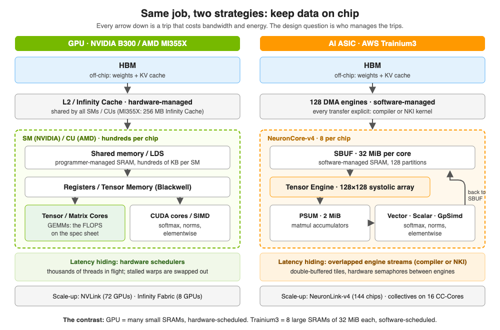
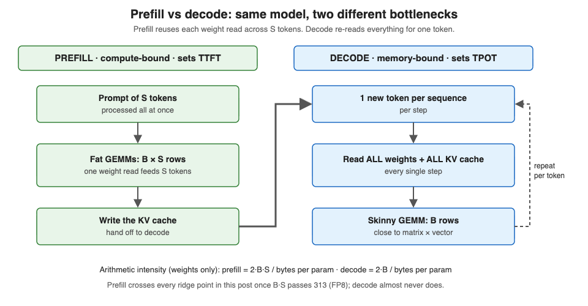
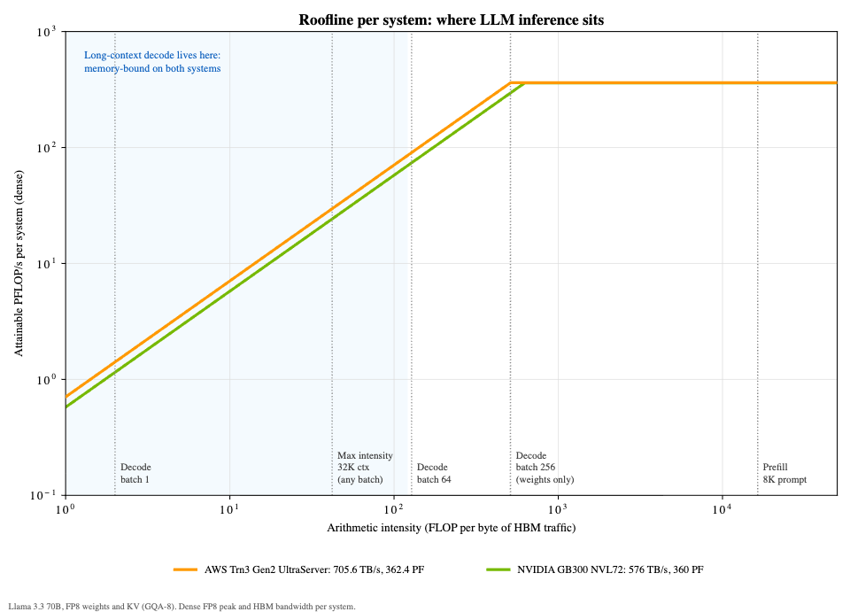
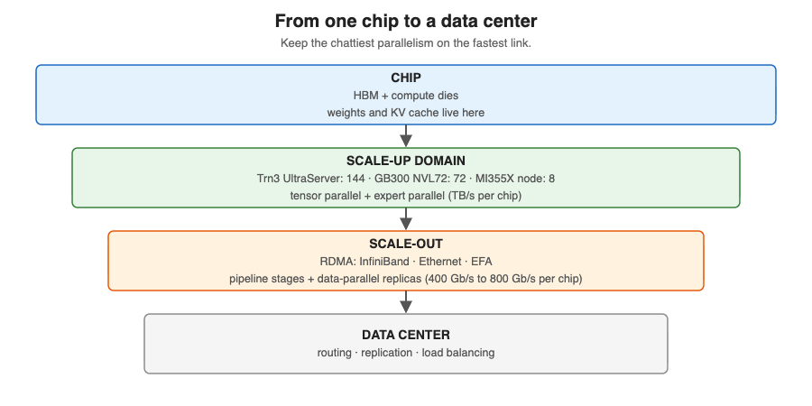
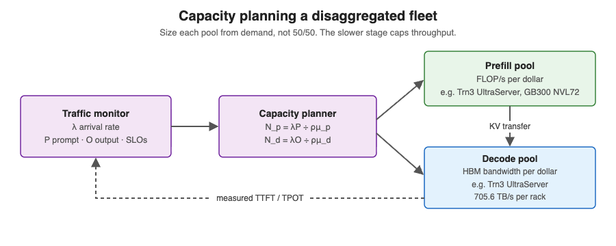

<details class="toc" markdown="1">
<summary>Table of contents</summary>

* TOC
{:toc}

</details>

---

## 0. The puzzle spec sheets cannot answer

An NVIDIA B300 and an AMD MI355X share the same headline numbers: 5 PF of dense FP8, 288 GB of HBM, 8 TB/s of bandwidth, 1,400 W. Serving DeepSeek R1, GB300 NVL72 and MI355X differ in measured cost per token by up to <b>3.22x</b>.

Now flip it. System for system, a 144-chip Trn3 Gen2 UltraServer matches a 72-GPU GB300 NVL72 on FP8 compute and HBM capacity and exceeds it on HBM bandwidth, built from 144 smaller chips. OpenAI Jalapeño has less HBM than a B300 and reports up to 1.9x more throughput per watt.

Same specs, different cost. Less memory, same performance. <b>None of the headline numbers explain any of this.</b> Performance comes out of a chain:

```txt
Model shape → workload shape → arithmetic intensity → bytes moved → energy per byte
→ compute → communication → scheduling → latency / throughput / cost per token
```

This post walks that chain once, and at every link asks the same question of the same chips. By the end one will be able to explain all three results from first principles before looking at a benchmark.

<div class="pullquote" markdown="1">
<b>The recurring theme:</b> do not optimize for the chip. Identify what prevents the chip from doing useful work, and remove that.
</div>

---

## 1. The chips, and the ten rules

### The chips in this post

| Chip | Type | Availability | Design focus |
| --- | --- | --- | --- |
| <b>NVIDIA</b> B300 (Blackwell Ultra) | General-purpose GPU | Available | Flexible GPUs on CUDA, with NVLink rack-scale domains |
| <b>AMD</b> Instinct MI355X | General-purpose GPU | Available | Flexible GPUs on ROCm |
| <b>AWS Trainium3</b> (Trn3 Gen2 UltraServer, 144 chips) | Hyperscaler ASIC for training and inference | Available on Amazon EC2 | Software-scheduled ASIC: compiler-managed SRAM, 16 dedicated collective cores per chip, and a 144-chip scale-up domain |
| <b>OpenAI Jalapeño</b> | Inference-only ASIC | OpenAI internal use | Inference ASIC built around OpenAI's own serving patterns: 15.4 TB/s of HBM bandwidth at 700 W |

### The ten rules that explain everything below

| Rule | Statement | Section |
| --- | --- | --- |
| Roofline | Attainable speed = min(peak compute, arithmetic intensity × memory bandwidth) | 3 |
| Memory-bandwidth lower bound | Each decode step reads every weight once, so step time ≥ weight bytes ÷ bandwidth | 3 |
| Weight reuse vs KV reuse | Batching shares weight reads; KV cache reads are per sequence unless sequences share a prefix | 3, 4 |
| KV size | Bytes per token = 2 × layers × KV heads × head dim × bytes per element | 4 |
| Data-movement energy | Reading a byte from DRAM costs far more energy than computing on it | 5 |
| Tile quantization | Fixed-size matrix tiles are paid for in full even when mostly empty | 6 |
| α–β model | Message time = α (startup latency) + size ÷ β (bandwidth) | 7 |
| Little's law | Requests in flight = arrival rate × time in system | 12 |
| Pipeline bottleneck | A pipeline runs at the speed of its slowest stage | 11, 12 |
| Queueing | Waiting time explodes as utilization approaches 100% | 12 |

---

## 2. What is physically different inside the chips

A GPU is thousands of programmable workers sharing caches the hardware manages. A domain-specific AI accelerator such as Trainium uses a few very large math engines fed by a scratchpad that software, the compiler or a custom kernel, fills ahead of time. Both are programmable. They differ in where the flexibility lives and who does the optimization work.

<figure></figure>

Both designs have software-managed SRAM: shared memory on a GPU, SBUF on Trainium3. The difference is what sits behind it. A GPU also has a hardware-managed L2 cache and hardware warp schedulers, so irregular access patterns and changing shapes are absorbed by cache hits and by switching to another warp.

Trainium3 replaces the hardware cache with explicit DMA: every byte moves on a schedule built ahead of time by the Neuron compiler or an NKI kernel. When the work is predictable, that schedule keeps every engine fed, and serving stacks compile one schedule per shape bucket to keep it that way. Trainium3 adds dynamic shapes and control flow to the NeuronCore-v4 ISA, so fewer buckets are needed. GPUs also move data under software control, through Blackwell's TMA and asynchronous copies, so the difference is the division of work: on a GPU, hardware caches and warp schedulers absorb what software leaves unplanned; on Trainium, the compiler or kernel plans the movement up front.

### Across the chips: anatomy

|  | NVIDIA B300 | AMD MI355X | AWS Trainium3 | OpenAI Jalapeño |
| --- | --- | --- | --- | --- |
| Compute units | Over 100 SMs, each with Tensor Cores and SIMD lanes | 256 CUs with Matrix Cores | 8 NeuronCore-v4, each a 128×128 systolic array plus vector, scalar, and GpSimd engines | Not disclosed |
| On-chip memory | Small shared memory per SM + hardware-managed L2 | LDS per CU + 256 MB Infinity Cache | 256 MiB software-managed SBUF (32 MiB per core) | Not disclosed |
| Control | Hardware warp schedulers | Hardware wavefront schedulers | Per-engine instruction streams built by the compiler or NKI, synchronized by hardware semaphores; ISA extensions for dynamic shapes and control flow | Not disclosed |
| Collectives | NCCL on the SMs | RCCL on the CUs | Neuron collectives (nccom) on 16 dedicated CC-Cores, SBUF to SBUF | Not disclosed |
| Low-precision formats (all also run BF16 and FP16) | FP8, MXFP8, MXFP6, MXFP4, NVFP4 | FP8, MXFP8, MXFP6, MXFP4 | FP8, MXFP8, MXFP4 | MXFP4 (only format disclosed) |
| Process | TSMC 4NP | TSMC 3 nm compute dies, 6 nm base dies | TSMC 3 nm | TSMC (reported) |

### Why build an ASIC at all

Every accelerator has the same three fixed budgets: <b>die area, power, and the HBM interface</b>. A GPU spends its budget on generality: thousands of thread contexts, register files, hardware schedulers, caches, and number formats some customer somewhere needs. That is insurance against unknown workloads. An ASIC asks what LLM inference actually binds on (bytes moved, on-chip reuse, chip-to-chip traffic), drops the insurance, and spends the budget there.

Think of a kitchen equipped for any cuisine against one built only for ramen. The ramen kitchen does not have a better chef. It has no idle equipment, and every square metre goes to the steps that slow ramen down.

GPUs are moving the same way. Blackwell Ultra cut FP64 from 40 TF per GPU in GB200 NVL72 (2,880 TF per rack) to 1.39 TF per GPU in GB300 NVL72 (100 TF per rack) and spent the area on FP4. MI355X still carries 78.6 TF of FP64 for HPC customers.

What the reallocation buys, beyond cost:

- <b>Communication that does not steal compute.</b> On GPUs, collectives run on the same SMs as the math. DeepSeek-V3 gave 20 of 132 H800 SMs (15.2%) to all-to-all, and asked hardware vendors to offload communication from the SMs. Trainium3 ships 16 dedicated collective cores per chip.
- <b>More on-chip memory for reuse.</b> Trainium3 has 8 × 32 MiB = 256 MiB of SBUF per chip. For scale, an H100 has 228 KB of shared memory per SM × 132 SMs = 30,096 KB.
- <b>Larger scale-up domains</b> (chips joined by the scale-up interconnect, before traffic leaves for the scale-out network). <b>Trn3 UltraServer:</b> 144 Trainium3 chips over NeuronLink-v4 through NeuronSwitch-v1. <b>Jalapeño</b>: 128 chips per rack over a local collective network, 2,048 per Ethernet pod. <b>GB300 NVL72</b>: 72 GPUs over NVLink.
- <b>More tokens per watt.</b> Jalapeño has 15.4 TB/s of peak HBM bandwidth on a 700 W chip power budget, 22.0 GB/s per watt. A B300 or an MI355X has 8 TB/s on 1,400 W, 5.71 GB/s per watt, 3.85x less. Trainium follows the same path: the Trn3 UltraServer delivers over 4x the energy efficiency of the Trn2 UltraServer.

### Less memory per chip, same performance

Trainium3 is a smaller chip than a B300 by design. How does it keep up?

Compare the unit you actually buy. Nobody serves a frontier model on one chip. You buy a fleet, and an ASIC chip is simply a smaller building block.

|  | NVIDIA GB300 NVL72 | AWS Trn3 Gen2 UltraServer |
| --- | --- | --- |
| Chips | 72 B300 | 144 Trainium3 |
| FP8 dense | 360 PF | 362.4 PF |
| HBM capacity (nominal) | 20.7 TB | 20.7 TB |
| HBM bandwidth | 576 TB/s | 705.6 TB/s |

Every figure is dense. NVIDIA's 720 PF headline for GB300 NVL72 counts FP8 with sparsity, and with sparsity Trainium3 runs BF16 at 2.517 PF per chip as well. The capacity worry is a per-chip artifact, and on HBM bandwidth, the number that sets decode speed, the UltraServer leads by 1.225x.

<b>FP4 on Trainium3.</b> Trainium3 runs FP8, MXFP8, and MXFP4 at 2.517 PF, and FP4 pays off where decode is limited: bytes. MXFP4 stores 4.25 bits per weight, one shared 8-bit scale per 32 values included, so the running example's weights shrink from 70.55 GB to 37.48 GB. Every decode step reads 53.125% of the bytes, and the freed HBM holds more KV cache, which means more conversations per chip.

Jalapeño makes the same argument from the other direction: less HBM than a B300 (216 GiB vs 288 GB) but 1.925x the bandwidth at half the power. Section 3 shows why capacity was never the scarce resource for decode; bytes per second were.

<b>What the reallocation trades.</b> Flexibility for efficiency. A new operator becomes a Triton or CUDA kernel on GPUs and an NKI kernel on Trainium, often starting from the open-source NKI Library. At large, steady scale the trade pays off, which is why Anthropic runs Project Rainier on nearly 500,000 Trainium2 chips.

<div class="callout callout-gray" markdown="1">
<span class="callout-icon">🎯</span>

<b>Interview Lens:</b> <i>Why compare Trainium3 per system and not per chip?</i> The system is the unit you buy. System for system, a Trn3 Gen2 UltraServer matches GB300 NVL72 on FP8 and HBM capacity and exceeds it on bandwidth. <i>Follow-up: which workload gains the most?</i> Decode, which runs on bandwidth: 705.6 TB/s against 576 TB/s.

</div>

---

## 3. Prefill vs decode: why one request stresses hardware two ways

<b>Prefill</b> reads the whole prompt at once: lots of math, very parallel. <b>Decode</b> writes one token at a time: very little math per step, but every step re-reads the weights (only the active experts in a MoE model) and each sequence's KV cache.

<figure></figure>

<b>Deep dive: tensor shapes.</b>

```txt
PREFILL (S prompt tokens)                 DECODE (1 new token per step)
Q:     [B, H,    S, D]                     Q:        [B, H,    1, D]
K, V:  [B, H_kv, S, D]                     K cache:  [B, H_kv, S, D]   read every step
MLP:   [B*S, d_model] x [d_model, d_ff]    V cache:  [B, H_kv, S, D]   read every step
       → fat matrix multiplies             MLP:      [B, d_model] x [d_model, d_ff]
                                                     → skinny, nearly matrix-vector
```

Changing <b>S to 1</b> is the whole story: the same weight matrix, multiplied by B rows instead of B × S rows.

<b>The roofline.</b> Arithmetic intensity is FLOPs per byte moved from memory. Every chip has a <b>ridge point</b>, peak FLOPs divided by peak bandwidth. Below the ridge the kernel is <b>memory-bound</b>: the math units wait for bytes and extra FLOPs do nothing. Above it, the kernel is <b>compute-bound</b>.

For FP8 decode, the weight reads alone give an arithmetic intensity of <b>2 × batch</b> FLOPs per byte (each weight byte does one multiply-add per sequence in the batch). For prefill it is 2 × batch × prompt length, far above any ridge.

<figure><figcaption>Roofline per system for the Trn3 Gen2 UltraServer and GB300 NVL72, with Llama 3.3 70B decode at batch 1, 64, and 256 (weights only), the maximum arithmetic intensity at 32K context for any batch, and an 8K-token prefill. Everything in the shaded band is memory-bound on both systems.</figcaption></figure>

<b>Latency is two numbers, throughput a third.</b> <b>TTFT</b> (time to first token) is driven by prefill plus queueing. <b>TPOT</b> (time per output token) is driven by decode. <b>Throughput</b>, in output tokens or requests completed per second, is measured at a given concurrency: more concurrent requests raise throughput until TTFT or TPOT misses its target. A chip can be great at one and mediocre at another, which is the root reason for prefill/decode disaggregation (Section 11).

### The running example

Every number from here on uses Meta Llama 3.3 70B (80 layers, 8 KV heads, head dim 128, 70.55B parameters), so 70.55 GB of FP8 weights and 160 KiB of FP8 KV cache per token, at the 8K-in / 1K-out shape SemiAnalysis InferenceX benchmarks. AWS Trainium figures are for Trainium3 and the 144-chip Trn3 Gen2 UltraServer.

Minimum time per token = 70.55 GB of weights ÷ HBM bandwidth. No kernel can beat it.

|  | NVIDIA GB300 NVL72 | AWS Trn3 Gen2 UltraServer |
| --- | --- | --- |
| HBM bandwidth per system | 576 TB/s | 705.6 TB/s |
| Minimum time per token (model on two B300s or one Trn3 server) | 4.41 ms | 3.60 ms |
| Max tokens/s for one user | 226 | 277 |
| Ridge point | 625 FLOP/B | 514 FLOP/B |
| Batch at which decode becomes compute-bound | 313 | 257 |

Each 576 GB of HBM, two B300s or one four-chip Trn3 server, holds one copy of the weights, the same unit Section 4 uses. In principle, a large enough batch lifts decode past the ridge. In practice, the KV cache stops every chip short of it, as the next section shows.

<div class="callout callout-gray" markdown="1">
<span class="callout-icon">🎯</span>

<b>Interview Lens:</b> <i>Why does doubling FLOPS not double tokens per second?</i> Decode sits on the sloped part of the roofline. Doubling FLOPS raises a ceiling decode never reaches. Doubling bandwidth moves the slope decode is actually on.

</div>

---

## 4. The KV cache: the capacity wall

Every token a user has sent or received leaves a record in memory, the KV cache. Batching is a carpool: one read of the weights serves every passenger. But every passenger brings luggage, its own KV cache, and the luggage does not shrink when you add riders. Add enough riders and you are mostly moving luggage.

```txt
KV bytes per token = 2 (K and V) × 80 layers × 8 KV heads × 128 head dim × 1 byte (FP8)
                   = 163,840 bytes = 160 KiB per token
4K-token sequence   → 0.671 GB
32K-token sequence  → 5.37 GB
128K-token sequence → 21.47 GB
```

With batch B, weight bytes are shared but KV bytes grow with B, so arithmetic intensity stops rising and converges to a per-sequence limit:

```txt
arithmetic intensity(B)  ≈  (2P + attention FLOPs) × B  /  (P × bytes_per_param  +  B × KV_bytes_per_seq)
B → ∞:        ≈  (2P + attention FLOPs)  /  KV_bytes_per_seq
```

| Context | KV per sequence | Max decode arithmetic intensity at any batch |
| --- | --- | --- |
| 8K | 1.34 GB | 121.1 FLOP/B |
| 32K | 5.37 GB | 42.3 FLOP/B |
| 128K | 21.47 GB | 22.6 FLOP/B |
| Limit (attention only, GQA-8, FP8 KV) | Grows with context | 16 FLOP/B |

Every value sits below every ridge point in Section 3 (514 FLOP/B). <b>At 8K context and beyond, this model's decode is memory-bound on every chip in this post, at any batch size.</b>

### Across the chips: how many conversations fit

FP8 stores each of Llama 3.3 70B's 70.55 billion parameters in 8 bits, one byte, so the weights take 70.55 GB. The rest of the HBM holds the KV cache, minus the activation and runtime buffers the serving engine reserves, so the counts below are upper bounds. Decode activations themselves are small: one MLP intermediate for 753 sequences is 753 × 28,672 × 2 bytes, 43.2 MB.

|  | AWS Trn3 Gen2 UltraServer | NVIDIA GB300 NVL72 |
| --- | --- | --- |
| HBM | 20.7 TB | 20.7 TB |
| HBM bandwidth | 705.6 TB/s | 576 TB/s |
| HBM left for KV cache (36 copies of the weights) | 18,196.1 GB | 18,196.1 GB |
| 4K-token sequences that fit | 27,108 | 27,108 |
| 32K-token sequences that fit | 3,384 | 3,384 |
| Arithmetic intensity at the 4K max batch | 198.55 FLOP/B | 198.55 FLOP/B |
| Share of the ridge point | 38.65% | 31.77% |

Each 576 GB of HBM, one Trn3 server, holds one copy of the weights and 753 conversations at 4K. Both systems hold 36 such copies and the same conversations, and the UltraServer reads their KV cache faster.

<b>The key insight.</b> Even with HBM packed full of conversations, decode runs at 38.65% of the ridge point or less. KV traffic grows with every sequence you add. That is why, for this model, memory bandwidth, HBM capacity, and KV cache design set decode speed, while extra peak FLOPS barely move it. Three things help: <b>more bandwidth per dollar or per watt </b>(the approach the Trn3 UltraServer and Jalapeño take),<b> more HBM capacity, and a different attention design such as MLA or KV quantization.</b>

<div class="callout callout-gray" markdown="1">
<span class="callout-icon">🎯</span>

<b>Interview Lens:</b> <i>Why can no chip make long-context GQA decode compute-bound?</i> Every sequence brings its own KV bytes, so arithmetic intensity converges to a per-sequence limit far below any ridge point. Raising that limit takes fewer KV bytes per token, as with MLA or KV quantization, or more queries per KV read, as with speculative decoding.

</div>

---

## 5. Energy: why inference ASICs exist at all

Math is cheap; moving data is expensive. In a data center with a fixed power budget, the chip that spends less energy moving bytes serves more tokens.

```txt
Energy per operation (45 nm process):
  32-bit read from off-chip DRAM  640 pJ
  32-bit floating-point multiply  3.7 pJ      → moving the data costs 173x the math

Bytes read per decode token (70.55 GB of FP8 weights):
  batch 1:   70.55 GB per token, 2 FLOPs per byte
  batch 64:  70.55 GB ÷ 64 = 1.10 GB per token
```

The 45 nm figures show the size of the gap between moving data and computing on it, not modern absolute values. At batch 1, decode does two FLOPs for every byte it pulls from HBM, so almost all of its energy goes to moving weights. Batching divides the weight bytes per token, which makes <b>batching an energy optimization, not only a throughput one</b>.

Three levers cut energy per token: keep more data on chip, move fewer bits per value, and spend silicon and power on data movement rather than on flexibility decode does not use.

### Across the chips: energy strategy

|  | NVIDIA | AMD | AWS Trainium | OpenAI Jalapeño |
| --- | --- | --- | --- | --- |
| Main lever | NVFP4 at 3x the FP8 rate: fewer bytes per weight | 3 nm compute dies on 6 nm base dies: more math per watt | Explicitly scheduled SRAM reuse (compiler or NKI); collectives that move data SBUF to SBUF | Bandwidth first: 15.4 TB/s at 700 W |

<b>Reading the table.</b> Both ASICs push energy efficiency. Jalapeño has 22.0 GB/s of peak HBM bandwidth per watt of chip power, 3.85x a B300, and that lead shows up in OpenAI's measured 1.5x to 1.9x throughput per watt. Each Trainium generation raises the bar: Trn3 delivers over 5x the output tokens per megawatt of Trn2. Efficiency follows where each design spends its power budget.

<div class="callout callout-gray" markdown="1">
<span class="callout-icon">🎯</span>

<b>Interview Lens:</b> <i>How can an inference ASIC beat a faster GPU on cost per token?</i> Decode is limited by bytes moved, and moving bytes is where the energy goes. A chip that moves bytes more cheaply serves more tokens per watt, and a power-capped data center converts tokens per watt directly into throughput.

</div>

---

## 6. Tile quantization: the hidden tax on small batches

Matrix units work on fixed-size blocks. If the block has room for 128 rows and you bring 8, you still pay for 128 and get 8. This is a simplified padding model: real utilization also depends on operand orientation, instruction granularity, and how the kernel maps the GEMM onto the hardware.

<figure></figure>

<figure><figcaption>Tile quantization: decode batch 8 on a 128-row tile does 6.25% useful work; batch 129 drops back to 50.39% because one extra row costs a whole tile.</figcaption></figure>

```txt
Useful fraction = rows ÷ (ceil(rows ÷ tile) × tile)
batch 8,   tile 128 → 6.25%
batch 128, tile 128 → 100%
batch 129, tile 128 → 50.39%   (one extra row costs a whole tile)
```

Prefill fills tiles easily (batch × prompt rows). Decode at small batch wastes most of each tile, on top of being memory-bound. Utilization counters can look healthy while most of the work is padding. At small batch the bandwidth limit binds first; tile quantization starts to cost real throughput as batch grows toward the ridge.

### Across the chips: matrix unit granularity

|  | NVIDIA | AMD | AWS Trainium | OpenAI Jalapeño |
| --- | --- | --- | --- | --- |
| Matrix unit | Tensor Core MMA with M of 64 or 128 per thread block, 256 per CTA pair (Blackwell) | MFMA on 16- or 32-row blocks per wavefront | 128×128 systolic array per NeuronCore | Not disclosed |
| Small-batch handling | Many small tiles run concurrently across SMs; split-K and stream-K | 16-row MFMA tiles; split-K and stream-K in hipBLASLt | Stationary operand loaded into the array, moving operand streamed; dynamic-shape ISA support means fewer padded shape buckets | Not disclosed |

<div class="callout callout-green" markdown="1">
<span class="callout-icon">🛠️</span>

<b>Takeaway:</b> set batch caps and shape buckets at tile multiples, and use speculative decoding to turn one-row decode into multi-row verification (Section 10).

</div>

---

## 7. Communication and scale-up

Large models span many chips, and chips must talk every layer. The <b>α–β model</b> gives the cost of each message: sending n bytes takes α + n ÷ β, where α is the fixed startup latency every message pays before any bytes flow and β is the link bandwidth. Small messages are dominated by α, large messages by n ÷ β.

<figure></figure>

```txt
Message time = α (startup latency) + size ÷ β (bandwidth)

Tensor-parallel decode, running example on 8 chips, 32 sequences, BF16 activations:
  one all-reduce = 32 × 8,192 × 2 bytes = 524,288 bytes   → time dominated by α
  2 all-reduces per layer × 80 layers = 160 per decode step
  → every generated token pays the fabric's startup latency 160 times
```

More link bandwidth barely helps here; lower latency does. That is why serving stacks ship one-shot all-reduce kernels for small messages, and why vendors push reductions into the fabric.

Each kind of parallelism puts a different load on the fabric:

| Parallelism | What is split | Traffic | Where it fits |
| --- | --- | --- | --- |
| Tensor (TP) | Each layer's matrices | Two all-reduces per layer, small and latency-bound | Inside the scale-up domain |
| Expert (EP) | MoE experts | Two all-to-alls per MoE layer | Inside the scale-up domain where possible |
| Pipeline (PP) | Groups of layers | Activations between stages, once per stage | Scale-up or scale-out |
| Data (DP) | Whole model replicas | None during serving | Anywhere |

Domain size is one factor for expert parallelism. Collective startup latency, topology, expert placement, routing imbalance, and overlap with compute decide the rest, and cross-node expert parallelism can still pay off when those are well managed.

### Across the chips: scale-up

| Platform | Fast domain | Link per chip | Who runs collectives | Beyond the domain |
| --- | --- | --- | --- | --- |
| NVIDIA GB300 NVL72 | 72 GPUs, one rack | 1.8 TB/s NVLink 5 (both directions) | NCCL on the SMs; in-switch reduction | RDMA, 57,600 Gb/s per NVL72 |
| AMD MI355X | 8 GPUs, one node | 1,008 GB/s Infinity Fabric (7 × 144 GB/s) | RCCL on the CUs | RDMA over Ethernet |
| AWS Trn3 UltraServer (Gen2) | 144 chips: 36 servers × 4 Trainium3 chips, across racks | NeuronLink-v4 through NeuronSwitch-v1: 2,560 GB/s per chip (both directions): 1,024 GB/s within a server, 1,280 GB/s across servers in a rack, 256 GB/s across racks | Neuron collectives (aws-neuronx-collectives) on 16 dedicated CC-Cores, SBUF to SBUF | EFA, 57,600 Gb/s per UltraServer |
| OpenAI Jalapeño | 128 chips per rack; 2,048 per pod at 200 GB/s per chip | 600 GB/s local collective network | Not disclosed | Broadcom Tomahawk 6 Ethernet across racks |

<b>The design bets:</b>

- <b>NVIDIA</b> joins 72 GPUs over NVLink, and the switches perform part of each reduction themselves, so collectives spend less time on the GPUs.
- <b>AMD</b> MI355X joins 8 GPUs per node over Infinity Fabric at 1,008 GB/s per GPU. Once expert parallelism spans more than 8 GPUs, the two all-to-alls in every MoE layer leave the node for the RDMA Ethernet scale-out network, and every decode step pays that slower hop.
- <b>Trainium3 UltraServer</b> keeps 144 chips in one NeuronLink-v4 domain through NeuronSwitch-v1: 2,560 GB/s per chip, 1,280 GB/s of it across servers. Expert parallelism can span all 144 chips without touching the scale-out network, and 16 dedicated CC-Cores per chip run the collectives, so communication does not compete with the compute engines.
- <b>Jalapeño</b> keeps 128 chips in a local domain and joins 16 racks into a 2,048-chip Ethernet pod. Its links run at 600 GB/s per chip, against 1.8 TB/s on GB300, while its HBM delivers 15.4 TB/s at 700 W (Section 5).

<div class="pullquote" markdown="1">
Interconnect bandwidth can matter more than another few hundred TFLOPS.
</div>

---

## 8. Software: the part that often decides real performance

A chip is only as fast as the code that runs on it. An excellent chip with a weak compiler loses to weaker hardware with a mature stack.

<figure></figure>

<b>Compilers and kernels.</b> Both platforms pair a compiler with hand-written kernels. A compiler fuses most of the graph (torch.compile on GPUs, the Neuron compiler on Trainium), and performance-critical operators are hand-tuned kernels (CUDA or Triton on GPUs, NKI on Trainium). The difference is scheduling: the Neuron compiler also plans every DMA transfer and engine instruction stream, work GPU hardware does at run time:

```txt
Model graph → compiler IR → fusion → tiling → SRAM placement → engine scheduling → accelerator instructions
```

Between NVIDIA and AMD the names differ but the concepts map closely; porting usually fails on tile shapes and wave-size assumptions, not syntax.

<b>The real jump is GPU to ASIC:</b> Trainium replaces warps and the hardware warp scheduler with compiled instruction streams: each engine runs its own stream asynchronously, and the compiler inserts semaphore synchronization between them. Occupancy gives way to overlap: the instruction streams must keep DMA transfers and the Tensor, Vector, Scalar, and GpSimd engines busy at the same time. Coalescing survives as DMA efficiency: a transfer needs at least 2 KiB of contiguous data per partition to approach peak bandwidth, and one large DMA beats many small ones. On top of that, you reason about SBUF partition layout and which operand stays stationary in the systolic array.

<b>Custom kernels exist on both sides.</b> On Trainium they are written in NKI (Neuron Kernel Interface), a bare-metal kernel language, written in Python, that exposes the NeuronCore ISA directly through <code>nki.isa</code>. AWS publishes the NKI Library, an open-source set of pre-built kernels optimized for Neuron devices, and NKI kernels drop into PyTorch and JAX models as custom operators. The difference from CUDA is what you control: no warps to schedule, but explicit tiles, SRAM placement, and DMA transfers.

### Across the chips: the kernel level

| Concept | NVIDIA | AMD | AWS Trainium | OpenAI Jalapeño |
| --- | --- | --- | --- | --- |
| Write a fused kernel in | CUDA, Triton, CUTLASS/CuTe | HIP, Triton, Composable Kernel | NKI (Python, direct ISA access) or the open-source NKI Library; Neuron compiler for the rest of the graph | Internal only |
| Execution unit | SM, warp of 32 threads | CU, wavefront of 64 | NeuronCore-v4: Tensor, Vector, Scalar, GpSimd engines. No warps | Not disclosed |
| Programmer SRAM | Shared memory | LDS | SBUF: 32 MiB per core, 128 partitions | Not disclosed |
| Accumulators | Registers; Tensor Memory on Blackwell | VGPRs / AGPRs | PSUM: 2 MiB per core | Not disclosed |
| HBM to SRAM movement | TMA, async copies | Global / buffer loads | 128 DMA engines, explicit in NKI, scheduled by the compiler | Not disclosed |
| Latency hiding | Hardware swaps warps | Hardware swaps wavefronts | Overlapped engine instruction streams: double-buffered tiles, semaphores between engines | Not disclosed |
| Profile with | Nsight Systems / Compute | rocprof, ROCm Compute Profiler | Neuron Explorer (neuron-profile) | Internal |
| Ecosystem | CUDA libraries and community kernels | ROCm, Composable Kernel, and upstream framework support | Open source: NKI Library, TorchNeuron, vLLM Neuron | Internal |

---

## 9. Optimization is bottleneck removal

Every optimization removes one specific bottleneck. Diagnose first, then pick.

| Symptom | Bottleneck | First fixes |
| --- | --- | --- |
| HBM bandwidth near peak, matrix units idle | Memory bandwidth (memory-bound) | Weight and KV quantization, fusion, larger batch |
| Matrix units saturated | Compute (compute-bound) | Lower precision, better tile shapes |
| Healthy utilization counters, low useful work | Tile quantization | Shape buckets at tile multiples, speculative decoding |
| Many tiny kernels, gaps on the timeline | Kernel launch overhead | Graph capture or static compilation, fusion |
| Chips waiting on each other | Inter-chip communication overhead | Lower tensor-parallel degree, one-shot all-reduce, overlap |
| Batch cannot grow, preemptions | HBM capacity (KV cache) | Paged KV, KV quantization, offload, more chips |
| Good kernels, bad latency | Queueing delay | Lower utilization target, PD disaggregation |

### Across the chips: same principle, different implementation

| Optimization | NVIDIA | AMD | AWS Trainium | OpenAI Jalapeño |
| --- | --- | --- | --- | --- |
| Continuous batching | vLLM, SGLang, TRT-LLM | vLLM, SGLang | vLLM Neuron; SGLang Neuron | Internal |
| Kernel fusion | Hand-written Triton/CUDA, torch.compile | Triton, Composable Kernel | Neuron compiler plus NKI kernels | Internal |
| FlashAttention-style tiling | FA3 / FA4-class kernels | Ported Triton and CK kernels | NKI flash attention kernel, SBUF-resident tiles | Internal |
| Quantization | FP8, MXFP8, MXFP6, MXFP4, NVFP4 | FP8, MXFP8, MXFP6, MXFP4 | FP8, MXFP8, MXFP4 | MXFP4 |
| Launch overhead fix | CUDA Graphs | HIP Graphs | Whole graph compiled per shape bucket and warmed up before serving | Not disclosed |
| Paged KV | PagedAttention | PagedAttention | Block KV layout tiled to DMA and SBUF | Not disclosed |
| Speculative decoding | EAGLE, MTP heads | EAGLE, MTP heads | EAGLE3 in vLLM Neuron | Not disclosed |
| PD disaggregation | Dynamo, vLLM, SGLang, llm-d | vLLM, SGLang, llm-d | vLLM Neuron , SGLang Neuron | Not disclosed |

<div class="callout callout-green" markdown="1">
<span class="callout-icon">🛠️</span>

<b>Takeaway:</b> the <i>principle</i> of an optimization transfers across hardware. The <i>implementation</i> often does not. Port the principle, then re-derive the implementation.

</div>

---

## 10. Five workload scenarios

<b>A. Large-batch prefill.</b> Compute-bound. Achievable dense low-precision FLOPS and long-sequence attention kernels decide. Dense FLOPS per dollar and per system decide the winner.

<b>B. Small-batch, latency-first decode.</b> Memory-bound, with kernel launch overhead on top. HBM bandwidth, quantization, static graphs, and speculative decoding decide. Look at measured TPOT, not specs.

<b>C. Long context.</b> KV capacity and KV bandwidth decide (Section 4).

<b>D. Mixture of Experts.</b> Each layer adds two all-to-alls, and the busiest device sets the pace. Large scale-up domains are built for this: the Trn3 UltraServer keeps all-to-all inside 144 chips and runs it on 16 dedicated CC-Cores, and Jalapeño keeps it inside a 128-chip local domain.

<figure></figure>

<b>E. Speculative decoding.</b> A small draft proposes K tokens and the target model verifies them in one pass, turning 1-row decode into (K+1)-row decode: higher arithmetic intensity, fuller tiles. If each draft token is accepted with probability α, one verification step emits (1 − α^(K+1)) ÷ (1 − α) tokens on average, so the gain grows with α and with how cheap the draft is. Gains shrink at high batch because batching already used the spare compute, so the best K falls as batch size rises.

### Across the systems: the five scenarios

| Scenario | AWS Trn3 Gen2 UltraServer | NVIDIA GB300 NVL72 |
| --- | --- | --- |
| A. Prefill | 362.4 PF of dense FP8 | 360 PF of dense FP8 |
| B. Low-latency decode | 3.60 ms minimum per token (Section 3) | 4.41 ms minimum per token (Section 3) |
| C. Long context | 20.7 TB of HBM; 3,384 conversations at 32K | 20.7 TB of HBM; 3,384 conversations at 32K |
| D. MoE | One 144-chip NeuronLink-v4 domain; collectives on dedicated CC-Cores | One 72-GPU NVLink domain; NCCL on the SMs with in-switch reduction |
| E. Speculative decoding | EAGLE3 in vLLM Neuron | EAGLE and MTP in TensorRT-LLM, vLLM, SGLang |

<div class="callout callout-gray" markdown="1">
<span class="callout-icon">🎯</span>

<b>Interview Lens:</b> <i>Why does MoE depend on the interconnect more than dense models do?</i> Two all-to-alls per layer, each costing startup latency plus bytes over bandwidth, and step time is the maximum over devices. Imbalance and fabric latency both add straight to TPOT.

</div>

---

## 11. Prefill-Decode disaggregation

Prefill wants compute. Decode wants bandwidth, KV capacity, and energy efficiency. Running both on the same chip makes each stall the other. Split them into two pools, and let each pool use the hardware that fits its job.

<figure></figure>

TTFT and TPOT get separate targets and separate tuning. And each pool can be sized for its own stage: FLOPS per dollar for prefill, HBM bandwidth per dollar for decode.

<b>The cost: moving the KV cache.</b>

```txt
KV transfer bytes/s = request rate × prompt tokens × KV bytes per token
Per request, running example: 8,192 prompt tokens × 160 KiB = 1.34 GB moved from prefill to decode
```

Total transfer is that figure times your request rate. Across <b>different</b> chip types, the KV layout and precision must also match or be converted, which is why both pools usually run on one platform.

<b>When it hurts:</b> short prompts or low load; small models that batch well on one chip; slow links between pools; a prompt:output mix that swings without autoscaling.

| Natural pool | NVIDIA | AMD | AWS Trainium | OpenAI Jalapeño |
| --- | --- | --- | --- | --- |
| Best fit | Prefill and decode | Prefill and decode | Decode and MoE serving; FP8 prefill | Decode-heavy interactive serving |
| Why | NVFP4 at 3x the FP8 rate; 72-GPU NVLink domain | ROCm stack; 8-GPU Infinity Fabric nodes | 705.6 TB/s of HBM bandwidth per UltraServer and a 144-chip domain | Bandwidth per watt |

---

## 12. Capacity planning: sizing each pool from demand

Prefill and decode form a two-stage pipeline: every request passes through prefill, then decode. A pipeline serves requests only as fast as its slower stage, so adding prefill nodes while decode is the bottleneck adds cost without adding throughput. Each pool is sized from the traffic it receives, not split 50/50. Two results from queueing theory do the sizing.

<b>Little's law.</b> In any stable system, the average number of items inside equals their arrival rate times the average time each one stays: L = λ × W. In decode the items are sequences, and each stays for O × TPOT, so sequences in flight = λ × O × TPOT. Every one of them holds its KV cache in HBM the whole time, which is what sets decode memory.

<b>Utilization and waiting.</b> When requests arrive at random and a single server handles them in turn (an M/M/1 queue), average waiting time grows as ρ ÷ (1 − ρ) times the service time, where ρ is utilization, the fraction of time a node is busy. Waiting rises without bound as ρ approaches 1, so every pool runs with ρ below 1.

```txt
Inputs
  λ      requests per second           P, O   average prompt and output tokens
  μ_p    prefill tokens/s per node at the TTFT target   (measure on your hardware)
  μ_d    decode tokens/s per node at the TPOT target    (measure on your hardware)
  ρ      target utilization, kept below 1 because waiting time explodes near 1

Prefill nodes   N_p = ceil( λ·P ÷ (ρ·μ_p) )
Decode nodes    N_d = ceil( λ·O ÷ (ρ·μ_d) )

Memory check (Little's law)
  sequences in flight  = λ · O · TPOT
  KV needed            = sequences × (P + O/2) × KV bytes per token
Link check             λ · P · KV bytes per token ≤ link bandwidth
```

<figure></figure>

<b>The shape of the traffic sets the fleet.</b> Two published InferenceX sequence shapes for the same model, and real multi-turn chat traffic:

| Sequence shape | Prefill tokens (P) | Decode tokens (O) | Decode : prefill tokens |
| --- | --- | --- | --- |
| 8K in / 1K out (RAG, long documents) | 8,192 | 1,024 | 1 : 8 |
| 1K in / 8K out (reasoning, agents) | 1,024 | 8,192 | 8 : 1 |
| Multi-turn chat (LMSYS-Chat-1M, per turn, 2.0 turns per conversation) | 69.5 new tokens | 214.5 | 3.09 : 1 |

N\_p scales with λ·P and N\_d with λ·O, so moving from the first shape to the second shifts the decode-to-prefill split by 64x at the same request rate, before any hardware choice. Same model, completely different fleet. Multi-turn chat sits in between, and prefix caching keeps its P at the new tokens of each turn; without it, every turn re-prefills the whole conversation.

### Across the chips: which chip for the decode pool

Decode is memory-bound (Sections 3 and 4), so to first order <b>decode throughput scales with HBM bandwidth, and decode cost with the price of that bandwidth</b>. That gives a one-line break-even test, per system, the unit you buy:

```txt
A system is cheaper for decode than GB300 NVL72 if:
  its cost (or power) ÷ GB300 NVL72 cost  <  its HBM bandwidth ÷ 576 TB/s
```

|  | NVIDIA GB300 NVL72 | AWS Trn3 Gen2 UltraServer |
| --- | --- | --- |
| HBM bandwidth | 576 TB/s | 705.6 TB/s |
| Bandwidth vs GB300 NVL72 | 1x | 1.225x |
| Wins decode if it costs less than | baseline | 1.225x a GB300 NVL72 |

<b>In dollars or in watts under a power cap, the Trn3 Gen2 UltraServer wins the decode pool</b> whenever it costs less than 1.225x a GB300 NVL72. In production, measured decode throughput replaces the bandwidth ratio, since kernels, MoE routing, and software shift it (Section 13).

<b>What a bandwidth-sized decode pool gives customers.</b> In the 1K in / 8K out shape, decode tokens outnumber prefill tokens 8 to 1, so the decode pool is most of the fleet. Sizing it for HBM bandwidth and capacity per dollar delivers:

- <b>Lower cost per output token.</b> Each dollar buys more bytes per second, and bytes per second generate decode tokens.
- <b>More concurrent users.</b> Each Trn3 server holds 753 conversations at 4K (Section 4), so a lower price per server means more conversations on the same budget.
- <b>Each stage sized on its own.</b> With disaggregation (Section 11), vLLM Neuron runs prefill and decode as separate Trainium pools and moves the KV cache between them over EFA, so each pool grows with its own stage.

<div class="callout callout-gray" markdown="1">
<span class="callout-icon">🎯</span>

<b>Interview Lens:</b> <i>You doubled prefill nodes and TTFT did not improve. Why?</i> Decode is probably the bottleneck: handed-off requests queue for decode slots. Recompute both pools from λ·P and λ·O, and check decode KV capacity with Little's law.

</div>

---

## 13. What a token costs

Spec sheets lead with peak FLOPS. Serving bills are paid per token. Most serving cost is decode, and decode is bound by HBM bandwidth, the scale-up fabric, and software, so <b>$/hour ÷ delivered tokens</b> decides fleet economics.

### ASICs: the principles hold in production

<b>AWS Trainium3 optimizes dollars.</b> Decode cost tracks the price of HBM bandwidth (Section 12), and the Trn3 Gen2 UltraServer delivers 705.6 TB/s against 576 TB/s for GB300 NVL72. Production results point the same way: Anthropic, Karakuri, Metagenomi, NetoAI, Ricoh, and Splash Music report up to 50% lower training and inference costs, Decart reports 4x faster real-time video inference at half the cost of GPUs, and Amazon Bedrock runs up to 3x faster on Trainium3 than on Trainium2.

<b>OpenAI Jalapeño optimizes watts.</b> At 3.85x the HBM bandwidth per watt of a B300 (Section 5), first principles predict an efficiency lead. OpenAI measured 1.5x to 1.9x more throughput per watt and 1.7x to 3.6x lower latency than GB200 and GB300 on InferenceX (GPT-OSS 120B, DeepSeek R1, Kimi K2.5; 8K in, 1K out; A0 silicon). The lead is smaller than the bandwidth ratio because not every step is memory-bound and because Jalapeño ran without multi-token prediction. Watts matter most when data center power, rather than budget, is the limit.

### Why per-chip specs do not set cost per token

This is the Section 0 puzzle: two GPUs with identical specs land up to 3.22x apart on cost per token. InferenceX run of November 5, 2026, DeepSeek R1, 8K in / 1K out, FP8, priced on hyperscaler ownership cost (GB300 $2.31/chip-hr, MI355X $1.50/chip-hr):

| Interactivity (tok/s/user) | GB300 NVL72 $/M tokens | MI355X $/M tokens | Cost gap |
| --- | --- | --- | --- |
| 66 | $0.083 | $0.244 | 2.94x |
| 112 | $0.134 | $0.432 | 3.22x |
| 159 | $0.643 | $1.091 | 1.70x |

- <b>Where the gap comes from.</b> MI355X costs 35.1% less per chip-hour, yet more per token, because GB300 serves more tokens per chip. DeepSeek R1 is MoE, and expert parallelism needs all-to-all every layer: on GB300 that traffic stays inside a 72-GPU NVLink domain, while on MI355X it leaves the 8-GPU node for scale-out networking (Section 7). Kernels and serving configuration differ too, and the benchmark measures their combined effect. Peak FLOPS, identical on both, is not the cause.
- <b>Software moves cost.</b> On the same GB300 NVL72 serving DeepSeek R1 in FP8, multi-token prediction reaches 73.7 tok/s/user at $0.093 per million tokens; without it, the fastest configuration reaches 45.0 tok/s/user at $0.107.
- <b>What favors ASICs.</b> One lever behind this gap, the scale-up domain, is where ASIC systems are built large: 144 chips on one NeuronLink-v4 domain in the Trn3 Gen2 UltraServer, 128 chips in Jalapeño’s local domain.

<div class="callout callout-green" markdown="1">
<span class="callout-icon">🛠️</span>

<b>Takeaway:</b> rank cost-per-token drivers in this order: software (speculative decoding, PD disaggregation, kernel quality) → $/chip-hr → HBM bandwidth → scale-up domain (MoE) → FP4 throughput (prefill) → FP8 peak. Peak FLOPS is last, not first. Count only tokens served within your TTFT and TPOT targets (goodput): a system that makes more tokens but misses the SLO costs more per useful token.

</div>

<div class="callout callout-gray" markdown="1">
<span class="callout-icon">🎯</span>

<b>Interview Lens:</b> <i>A Trn3 UltraServer and a GB300 NVL72 deliver the same FP8 PFLOPS. Which costs less per token?</i> For decode-heavy serving, the one with more HBM bandwidth per dollar, because decode is memory-bound. The UltraServer reads weights and KV cache at 705.6 TB/s against 576 TB/s, and keeps MoE all-to-all inside 144 chips. Software then decides how much of that bandwidth becomes tokens, through kernel quality and speculative decoding.

</div>

---

## 14. Choosing hardware

### Which spec to compare first

| Your workload | Bottleneck | Compare this first |
| --- | --- | --- |
| Long prompts, short answers (RAG, summarization) | Prefill compute | Achievable FP8 or FP4 FLOPS per dollar |
| Short prompts, long answers (reasoning, agents) | Decode memory bandwidth | HBM bandwidth per dollar and per watt |
| Long context | KV capacity | HBM capacity per system |
| MoE | All-to-all latency, imbalance | Scale-up domain size and collective latency |
| Strict per-user latency | Minimum time per token | Measured TPOT at your batch |
| Research, fast-changing models | Kernel availability | Kernel and framework coverage for your models |
| Large, shifting mix of the above | Pipeline bottleneck | Separate pools sized by capacity planning |
| Existing custom kernels | Porting effort | Kernels to rewrite in the target language: CUDA, HIP, or NKI |

<div class="pullquote" markdown="1">
<b>There is no universally faster accelerator. There is only an accelerator better matched to a particular workload stage, software stack, and deployment objective.</b>
</div>

---

<div class="callout callout-purple" markdown="1">
<span class="callout-icon">🧩</span>

<b>One question to leave you with.</b> On Trainium every decision is explicit, and a good schedule keeps every engine busy. Someone has to choose which matrix stays stationary in a 128×128 systolic array, what lives in 32 MiB of SBUF per core, and when each of 128 DMA engines fires. The Neuron compiler makes those choices automatically, and NKI gives kernel engineers direct control when they want it. So what does one attention layer look like on Trainium, and where does a custom NKI kernel beat the compiler?

</div>

---

## Sources

### Benchmarks

- [SemiAnalysis InferenceX: DeepSeek R1, GB300 NVL72 vs MI355X](https://inferencex.semianalysis.com/compare-per-dollar/deepseek-r1-gb300-vs-mi355x/8k-1k)
- [SemiAnalysis InferenceX: supported accelerators](https://inferencex.semianalysis.com/about)
- [OpenAI: Jalapeño first results](https://openai.com/index/jalapeno-first-results/)
- [SemiAnalysis: OpenAI Jalapeño, Better Than Nvidia Blackwell](https://inferencex.semianalysis.com/blog/openai-jalapeno-better-than-nvidia)

### Papers, models, and data

- [Williams, Waterman, Patterson: Roofline, CACM 2009](https://dl.acm.org/doi/10.1145/1498765.1498785)
- Hockney: The communication challenge for MPP, Parallel Computing 1994
- Horowitz: Computing's Energy Problem, ISSCC 2014
- Little: A Proof for the Queuing Formula L = λW, Operations Research 1961
- [Leviathan, Kalman, Matias: Fast Inference from Transformers via Speculative Decoding, ICML 2023](https://arxiv.org/abs/2211.17192)
- [DeepSeek-V3 Technical Report](https://arxiv.org/pdf/2412.19437)
- [Llama 3.3 70B config](https://huggingface.co/unsloth/Llama-3.3-70B-Instruct-bnb-4bit/raw/main/config.json)
- [LMSYS-Chat-1M](https://arxiv.org/html/2309.11998v4)
- [OCP Microscaling Formats v1.0](https://www.opencompute.org/documents/ocp-microscaling-formats-mx-v1-0-spec-final-pdf)

### NVIDIA

- [GB300 NVL72](https://www.nvidia.com/en-us/data-center/gb300-nvl72/)
- [GB200 NVL72](https://www.nvidia.com/en-us/data-center/gb200-nvl72/)
- [Hopper tuning guide](https://docs.nvidia.com/cuda/hopper-tuning-guide/index.html)
- [Matrix multiplication background guide](https://docs.nvidia.com/deeplearning/performance/dl-performance-matrix-multiplication/index.html)
- [CUTLASS: Blackwell formats](https://www.mintlify.com/NVIDIA/cutlass/architectures/blackwell)
- [CUDA C++ Programming Guide: hardware multithreading](https://docs.nvidia.com/cuda/cuda-c-programming-guide/)
- [PyTorch: torch.compile](https://docs.pytorch.org/docs/stable/torch.compiler.html)

### AMD

- [Instinct MI355X](https://www.amd.com/en/products/accelerators/instinct/mi350/mi355x.html)
- [ROCm: MI350 Series microarchitecture](https://rocm.docs.amd.com/en/latest/reference/gpu-arch/mi350.html)
- [Wccftech: MI355X launch](https://wccftech.com/amd-instinct-mi350-mi355x-launched-3nm-185-billion-transistors-288-gb-hbm3e-fp4-fp6-2-2x-faster-blackwell-b200/)

### OpenAI Jalapeño

- [OpenAI and Broadcom: Jalapeño](https://openai.com/index/openai-broadcom-jalapeno-inference-chip/)
- [ServeTheHome: Jalapeño at Hot Chips 2026](https://www.servethehome.com/openai-jalapeno-asic-at-hot-chips-2026/)
- [Tom's Hardware: Jalapeño at Hot Chips 2026](https://www.tomshardware.com/tech-industry/artificial-intelligence/hot-chips-2026-openais-jalapeno-ai-asic-unpacked-accelerator-developed-using-ai-achieves-efficiency-and-throughput-gains-against-power-hungry-blackwell)
- [Tom's Hardware: Jalapeño for internal use](https://www.tomshardware.com/tech-industry/artificial-intelligence/openais-custom-jalapeno-ai-inference-asic-is-for-openais-internal-use-but-company-leaves-the-door-open-to-broader-rollout-firm-says-it-will-have-its-hands-full-with-jalapeno-for-a-good-long-time)
- [HotHardware: Jalapeño](https://hothardware.com/news/openai-broadcom-reveal-jalapeno-ai-chip)

### AWS Trainium

- [Amazon EC2 Trn3](https://aws.amazon.com/ec2/instance-types/trn3/)
- [Amazon: Trainium3 UltraServers now available](https://press.aboutamazon.com/2025/12/trainium3-ultraservers-now-available-enabling-customers-to-train-and-deploy-ai-models-faster-at-lower-cost)
- [Amazon: Project Rainier](https://aboutamazon.com/news/aws/aws-project-rainier-ai-trainium-chips-compute-cluster/)
- [Neuron: Trainium3 specifications](https://awsdocs-neuron.readthedocs-hosted.com/en/latest/about-neuron/arch/neuron-hardware/trainium3.html)
- [Neuron: Trn3 architecture](https://awsdocs-neuron.readthedocs-hosted.com/en/latest/about-neuron/arch/neuron-hardware/trn3-arch.html)
- [Neuron: Trainium3 architecture guide for NKI](https://awsdocs-neuron.readthedocs-hosted.com/en/latest/nki/guides/architecture/trainium3_arch.html)
- [Neuron: Trainium architecture guide for NKI](https://awsdocs-neuron.readthedocs-hosted.com/en/v2.32.0/_sources/nki/guides/architecture/trainium_inferentia2_arch.rst)
- [Neuron: NKI DMA bandwidth guide](https://awsdocs-neuron.readthedocs-hosted.com/en/latest/nki/deep-dives/nki-dma-bandwidth-guide.html)
- [Neuron: NKI](https://awsdocs-neuron.readthedocs-hosted.com/en/v2.31.0/_sources/nki/index.rst)
- [Neuron: collective communication](https://awsdocs-neuron.readthedocs-hosted.com/en/latest/general/arch/neuron-features/collective-communication.html)
- [Neuron: developer tools](https://awsdocs-neuron.readthedocs-hosted.com/en/latest/_sources/tools/index.rst)
- [Neuron: speculative decoding in vLLM Neuron](https://awsdocs-neuron.readthedocs-hosted.com/en/latest/_sources/vllm-neuron/docs/design/speculation/speculative_decoding_design.md)
- [Neuron: disaggregated inference in vLLM Neuron](https://awsdocs-neuron.readthedocs-hosted.com/en/latest/_sources/vllm-neuron/docs/design/vllm/disaggregated-inference.md)
- [GitHub: NKI Library](https://github.com/aws-neuron/nki-library)
- [GitHub: TorchNeuron](https://github.com/aws-neuron/torch-neuronx)
- [GitHub: vLLM Neuron](https://github.com/vllm-project/vllm-neuron)
- [LMSYS: SGLang Trainium plugin beta](https://www.lmsys.org/blog/2026-10-22-sglang-trainium-beta)
- [SemiAnalysis: Trainium3 deep dive](https://newsletter.semianalysis.com/p/aws-trainium3-deep-dive-a-potential)
- [Tom's Hardware: Trainium3 launch](https://www.tomshardware.com/tech-industry/artificial-intelligence/amazon-launches-trainium3-ai-accelerator-competing-directly-against-blackwell-ultra-in-fp8-performance-new-trn3-gen2-ultraserver-takes-vertical-scaling-notes-from-nvidias-playbook)
